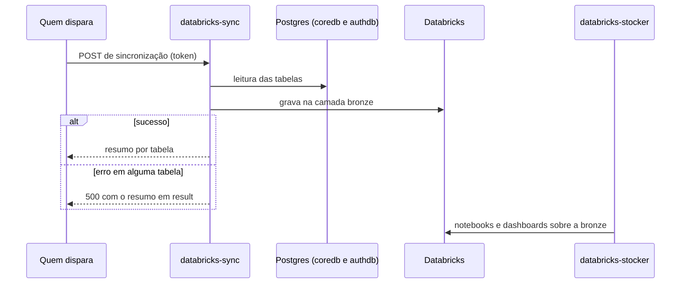

# Cópia dos dados para análise

Os bancos de negócio e de autenticação são copiados para a camada bronze no Databricks, onde os notebooks e dashboards do `databricks-stocker` trabalham. A cópia é disparada à mão, sem agendamento, para não consumir a cota gratuita.

- O schema dos dois bancos é mantido no `database-console`.
