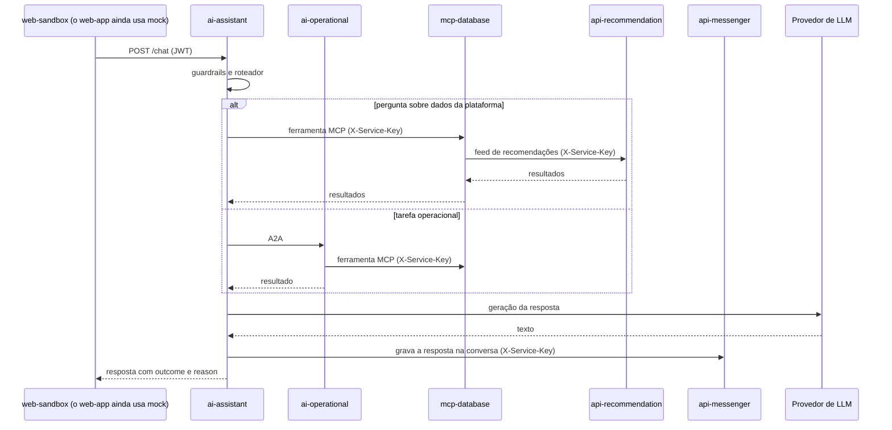

# Conversa com o assistente

O `ai-assistant` recebe a mensagem, decide quem responde e grava a conversa no `api-messenger`. Para dados da plataforma ele usa as ferramentas do `mcp-database`. Tarefas operacionais ele delega ao `ai-operational` pelo protocolo A2A.

- O `outcome` diz como o turno terminou (`ANSWERED`, `REFUSED`, `DEGRADED`, `TOOL_FAILED`) e o `reason`, o motivo. Os três agentes de conversa usam os mesmos valores.
- O `ai-geographic` também conversa com o assistente pelo A2A, para perguntas de localização, e usa o `api-google`.
