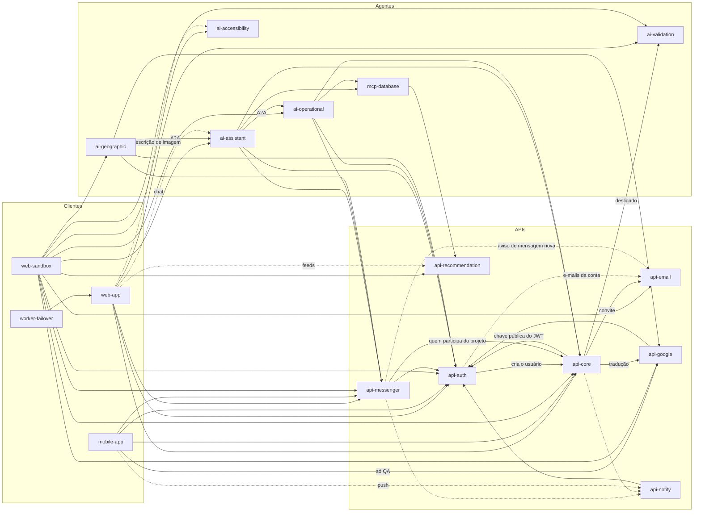

# Visão geral das integrações

Quem chama quem na plataforma. Setas cheias são integrações ligadas. Setas tracejadas são previstas e ainda não ligadas. Bancos e provedores externos ficam nos documentos de cada repositório.

## Peso de cada repositório

- `api-auth`, `api-core` e `api-messenger` concentram o tráfego. Uma mudança neles afeta quase toda a plataforma.
- `api-notify`, `ai-accessibility`, `api-recommendation`, `api-email` e `ai-geographic` estão no ar, mas nenhum cliente final chega neles ainda.
- O `web-sandbox` é o portal do QA e chama todas as APIs para teste.

## Dados

| Banco | Dono | Quem também lê |
|---|---|---|
| Postgres de negócio (`coredb`) | `api-core`, com o schema no `database-console` | `mcp-database`, `api-recommendation`, `database-bootstrap`, `database-rpa`, `databricks-sync` |
| Postgres de autenticação (`authdb`) | `api-auth`, com o schema no `database-console` | `databricks-sync` |
| Mongo de conversas | `api-messenger` | |
| Mongo de notificações | `api-notify` | |
| Mongo, Qdrant e Redis dos agentes | `ai-assistant` | `ai-operational`, `ai-geographic` |
| Neo4j de recomendações (`feeddb`) | `api-recommendation` | escrito pelo `database-bootstrap` |
| Firestore | `web-app` (indicador de digitação) | |
| Redis da plataforma | `api-auth` e `api-core` | |
