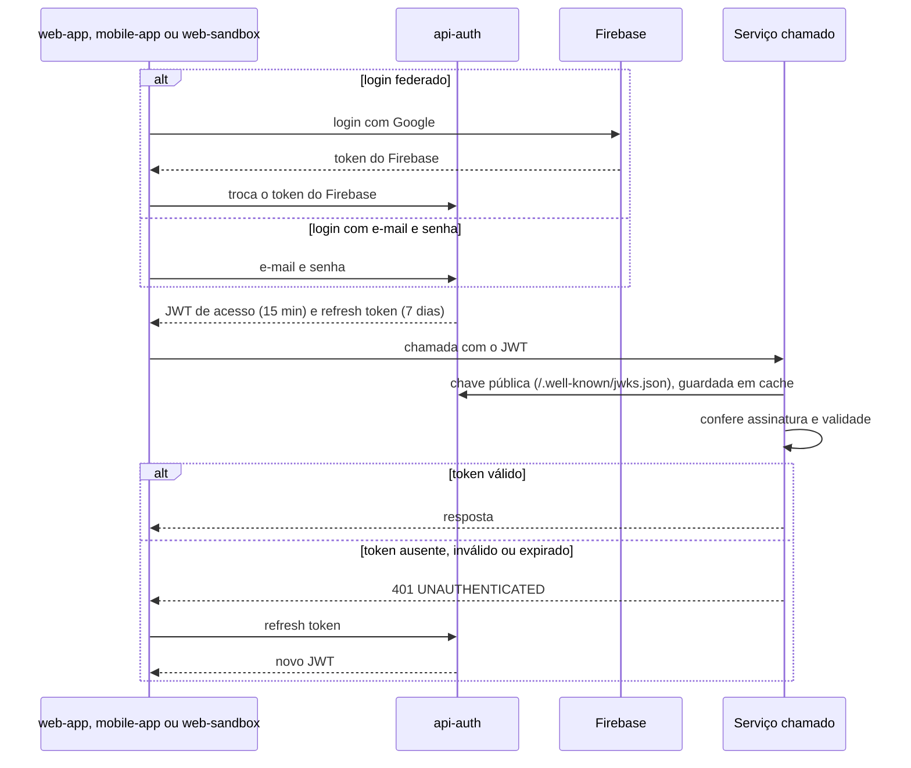

# Login e validação do token

A pessoa entra uma vez pelo `api-auth` e recebe um JWT. Os outros serviços não consultam o `api-auth` a cada chamada. Eles baixam a chave pública dele e conferem a assinatura do token localmente.

- O app mobile entra por deeplink com PKCE.
- O JWT é assinado com RS256. Cada serviço recebe o endereço da chave pública por variável (`JWT_JWK_SET_URI` nos serviços Spring, `JWT_JWKS_URL` nos agentes).
- Os erros seguem o [contrato de erro](../standards/ERRORS.md).
