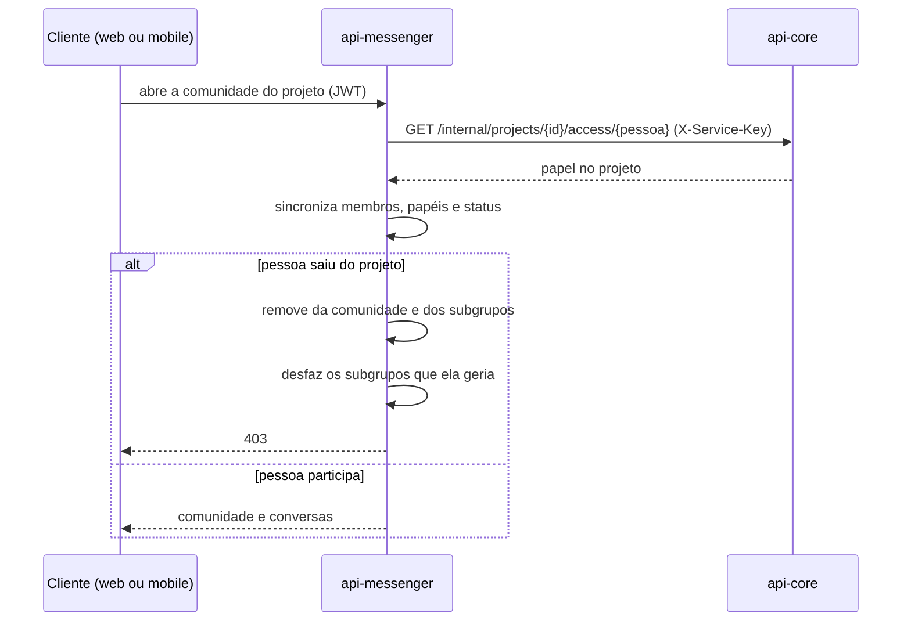

# Comunidade de projeto

Cada projeto tem uma comunidade no `api-messenger`, com a equipe e o cliente. Quem participa e com qual papel não é decidido no `api-messenger`. Ele pergunta ao `api-core`, que é dono do projeto, e sincroniza a comunidade a cada acesso.

- Os papéis do projeto viram papéis da comunidade. OWNER continua OWNER, MANAGER vira ADMIN, MEMBER continua MEMBER e VIEWER continua VIEWER, que só lê.
- Projeto encerrado deixa a comunidade arquivada.
- Toda comunidade ativa com pelo menos dois membros tem a conversa geral do projeto, com todos dentro.
