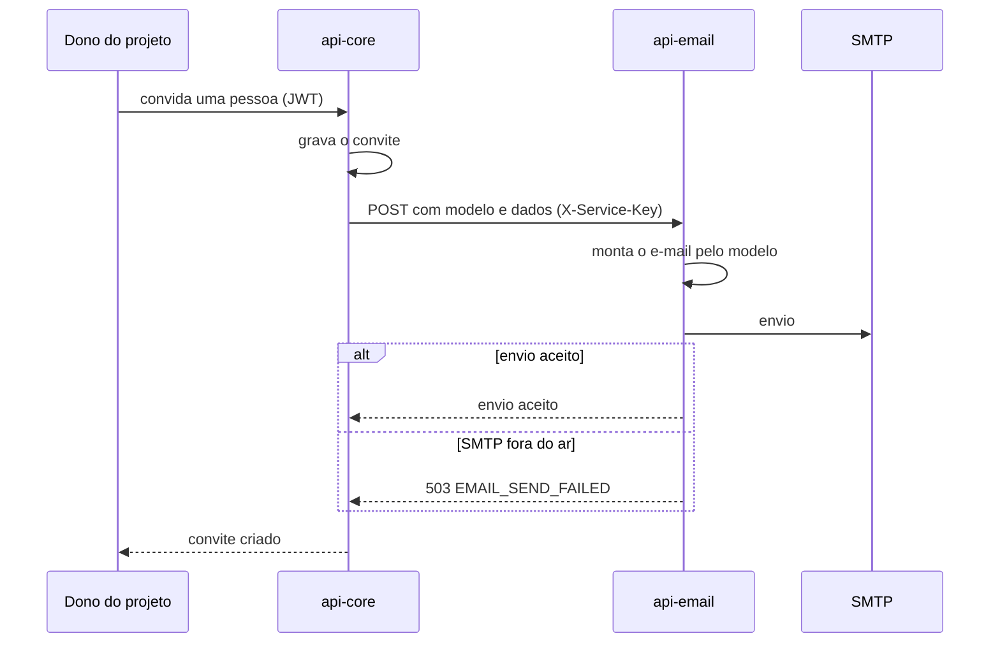

# Convite de projeto por e-mail

Quando alguém é convidado para um projeto, o `api-core` pede ao `api-email` o envio do convite. O `api-email` monta o e-mail a partir do modelo e envia por SMTP.

- Os e-mails da conta (confirmação, recuperação de senha) ainda saem por SMTP próprio do `api-auth` e devem passar pelo `api-email` no futuro.
