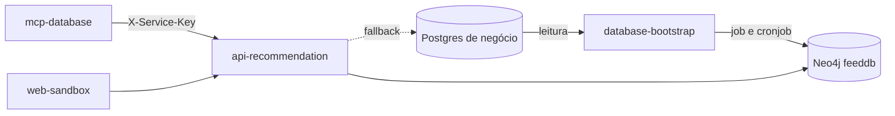

# Feed de recomendações

As recomendações de profissionais, ofertas e fornecedores vêm de um grafo no Neo4j. O `database-bootstrap` monta o grafo a partir do Postgres de negócio, e o `api-recommendation` consulta o grafo. Se o grafo não responde, ele cai para uma consulta direta ao Postgres.

- Hoje o feed chega ao usuário só pelo assistente, através do `mcp-database`. O `web-app` e o `mobile-app` ainda não consomem os feeds.
