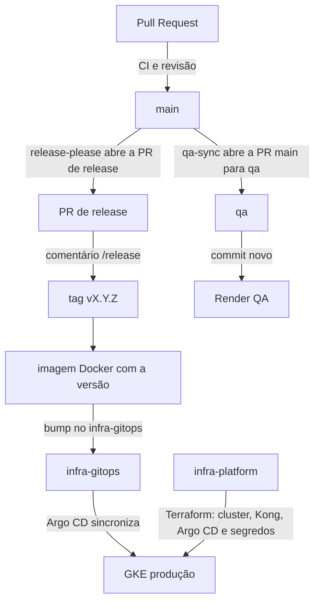

# Release e deploy

Toda mudança entra na `main` por Pull Request. O QA roda a branch `qa` no Render, e a produção roda no GKE pelo Argo CD, com a imagem do release.

- O sentido é sempre da `main` para a `qa`. Levar algo da `qa` para a `main` é exceção e passa por Pull Request revisada.
- O ambiente aparece no GitHub de cada repositório pelo workflow `environment-status`, que confere o caminho de pronto.
- Os detalhes por plataforma ficam em [`readme/deploy/`](../../readme/deploy/), e a versão em [VERSIONING.md](../standards/VERSIONING.md).
