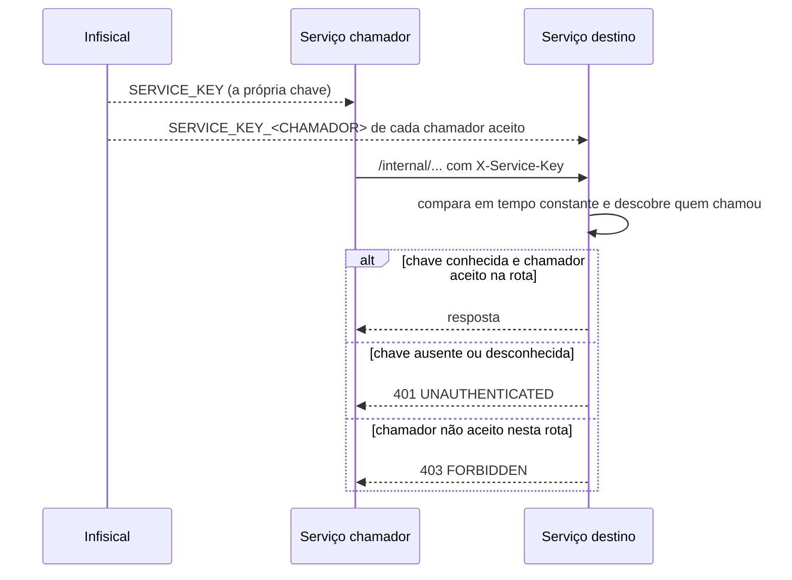

# Chamada entre serviços

Quando um serviço chama outro em nome de si mesmo, e não de uma pessoa, ele se identifica pelo cabeçalho `X-Service-Key`. Cada serviço tem a própria chave, e o destino diz quais chamadores aceita em cada rota. O padrão completo está em [SERVICE_AUTH.md](../standards/SERVICE_AUTH.md).

- As chaves ficam na pasta `/service-keys` do Infisical, nos ambientes `local`, `qa` e `prod`.
- As rotas `/internal/**` não aparecem no Swagger público. Elas ficam documentadas no `openapi.yaml` do repositório.
- Quando o serviço age em nome de uma pessoa, como os agentes ao ler dados do usuário, ele repassa o JWT da pessoa em vez da chave.
