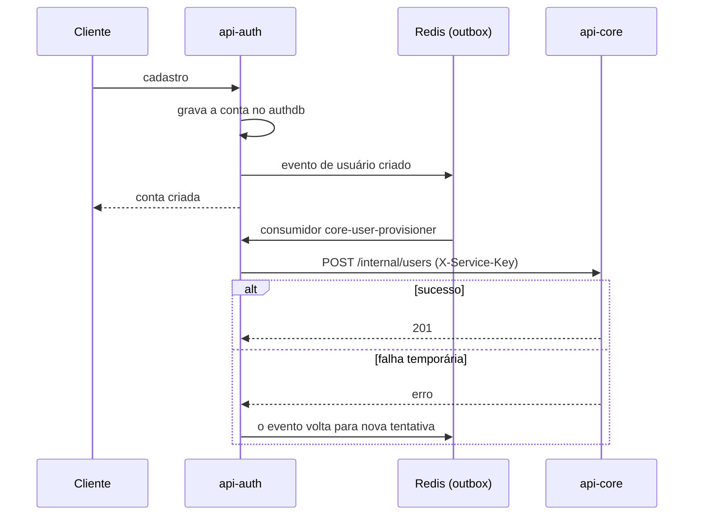

# Criação do usuário no cadastro central

A conta nasce no `api-auth`, que guarda só identidade e sessão. O perfil de produto (cliente, profissional, empresa) fica no `api-core`. Para os dois ficarem sincronizados, o `api-auth` publica o evento numa fila e um consumidor cria o usuário no `api-core`.

- A rota `/internal/users` do `api-core` só aceita o `api-auth`, pela [autenticação entre serviços](./SERVICE_TO_SERVICE_AUTH.md).
- Como o envio é assíncrono, o perfil pode demorar alguns segundos para aparecer no `api-core` depois do cadastro.
