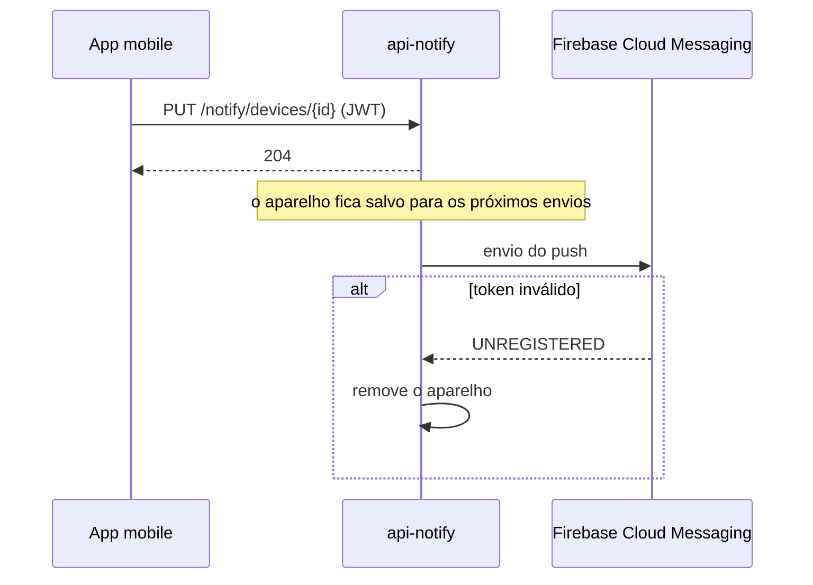

# Diagramas

Os diagramas são escritos em Mermaid, dentro do próprio Markdown, para o GitHub renderizar e para mudarem junto com o texto. Imagem exportada só entra quando o Mermaid não consegue representar o caso, e então vai para `assets/`.

## Tipo por caso

| Caso | Tipo | Onde |
|---|---|---|
| Componentes e dependências de um repositório | `flowchart LR` | `docs/ARCHITECTURE.md` |
| Fluxo de chamadas entre peças, com ordem | `sequenceDiagram` | `flows/` |
| Fluxo de decisão, com caminhos alternativos | `flowchart TD` | `flows/` |
| Estados de uma entidade (pedido, conversa, projeto) | `stateDiagram-v2` | `flows/` ou `docs/OVERVIEW.md` |
| Modelo relacional | `erDiagram` | `database/` |
| Documento de banco não relacional | `classDiagram` com os campos | `database/` |

## Regras

- Nomes de participantes e caixas em português, exceto nomes de serviço e de código (`api-auth`, `ProjectService`).
- Participantes externos com o nome do provedor (Firebase, Google Maps, Gemini).
- Um diagrama por ideia. Se ele passa de uns 15 nós ou 20 mensagens, dividir.
- Toda seta de chamada entre serviços diz o protocolo e a autenticação quando isso importa (`HTTP + X-Service-Key`, `WebSocket + JWT`).
- Casos de erro em `alt` no diagrama de sequência ou num caminho próprio no fluxograma.
- Sem cores e estilos customizados. O tema padrão do GitHub funciona no claro e no escuro.

## Exemplo

