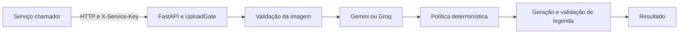

  

# Arquitetura

A API FastAPI separa validação de arquivo, sinais de visão, política determinística e validação da legenda. A fonte da decisão está em [policy.py](https://github.com/Solierrr/ai-accessibility/blob/main/src/moderation/policy.py).

| Pasta | Papel |
|---|---|
| `src/api/` | Rotas, autorização, limite bruto e erros |
| `src/image/` | Decodificação e normalização |
| `src/moderation/` | Sinais e política de decisão |
| `src/providers/` | Clientes de visão e prompts |
| `src/services/` | Pipeline e reexecução administrativa |

O arquivo é autenticado antes do parser multipart na rota principal. A normalização remove metadados, aplica orientação e aceita somente JPEG, PNG e WebP de um quadro. O limite é oito MiB, vinte milhões de pixels e 8192 pixels por lado.

Gemini é preferido quando configurado. Groq pode funcionar como principal ou fallback técnico. Um bloqueio de segurança não é contornado por fallback. O processamento tem semáforo configurável. O `/health` informa versão de `version.txt` e `/ready` verifica configuração de provedor, sem chamada remota.

Não há banco próprio. O debug guarda imagens temporariamente em memória para replay, com expiração de quinze minutos, limite de dez execuções por administrador e orçamento global de 64 MiB. Os dados somem em reinício. A integração entre serviços está no [mapa central](https://github.com/Solierrr/docs-warehouse/blob/main/docs/flows/INTEGRATIONS.md).
