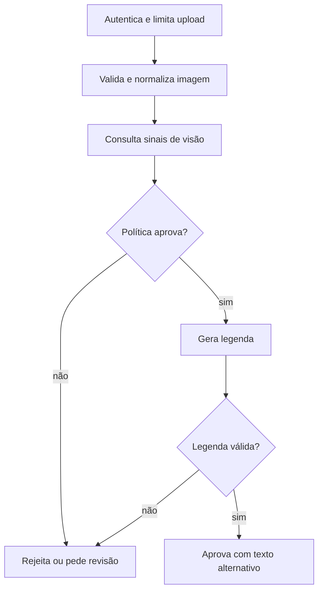

  

# Análise e descrição

O fluxo recebe uma imagem e devolve decisão com descrição apenas quando as etapas permitem aprovação.

Um arquivo inválido impede a análise, e a incerteza, o risco ou um bloqueio de segurança levam a imagem para revisão. Uma falha técnica pode acionar o provedor alternativo, mas isso nunca autoriza contornar um bloqueio de segurança, e o serviço não publica a imagem depois da aprovação.