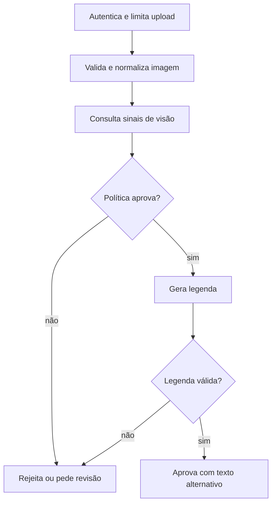

  

# Análise e descrição

O fluxo recebe uma imagem e devolve decisão com descrição apenas quando as etapas permitem aprovação.

Arquivo inválido impede a análise. Incerteza, risco ou bloqueio de segurança exige revisão. Falha técnica pode usar o provedor alternativo, mas não autoriza contornar um bloqueio de segurança. O serviço não publica a imagem após a aprovação.
