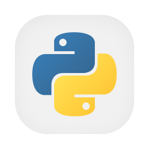
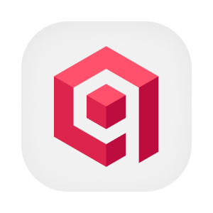

  

  
  
  
  
  
  

# Assistente de recomendações

O assistente ajuda quem procura equipamentos, profissionais e fornecedores para um projeto de energia solar. Ele reúne as necessidades informadas na conversa, consulta dados da plataforma e explica as alternativas encontradas. Também oferece estimativas preliminares e encaminha pedidos de operação ao agente responsável por executar ações.

A conversa usa especialistas organizados em um grafo, com memória no MongoDB e consulta ao FAQ no Qdrant. O acesso depende do JWT da pessoa. As recomendações são obtidas por ferramentas e os registros da conversa são enviados ao serviço de mensagens. Outros agentes podem consultar o mesmo assistente pelo protocolo de delegação.

## Aprofunde-se no Projeto!

- [OVERVIEW.md](./docs/OVERVIEW.md), finalidade e regras de produto.
- [ARCHITECTURE.md](./docs/ARCHITECTURE.md), componentes, dados e integrações.
- [RUNNING.md](./docs/RUNNING.md), preparação e execução local.
- [API.md](./docs/API.md), autenticação e uso do contrato.
- [DEPLOY.md](./docs/DEPLOY.md), ambientes e publicação.
- [STATUS.md](./docs/STATUS.md), limites observados.
- [MONGO.md](./database/MONGO.md), detalhes do fluxo ou modelo de dados.
- [QDRANT.md](./database/QDRANT.md), detalhes do fluxo ou modelo de dados.
- [REDIS.md](./database/REDIS.md), detalhes do fluxo ou modelo de dados.
- [CHAT_TURN.md](./flows/CHAT_TURN.md), detalhes do fluxo ou modelo de dados.
- [DELEGATION_A2A.md](./flows/DELEGATION_A2A.md), detalhes do fluxo ou modelo de dados.
- [GUARDRAILS.md](./flows/GUARDRAILS.md), detalhes do fluxo ou modelo de dados.
- [PENDENCIAS.md](./PENDENCIAS.md), questões para revisão.

## Contribuindo

- [CONTRIBUTING.md](https://github.com/Solierrr/.github/blob/main/.github/CONTRIBUTING.md), convenções de contribuição.
- [CODE_OF_CONDUCT.md](https://github.com/Solierrr/.github/blob/main/CODE_OF_CONDUCT.md), código de conduta.
- [SECURITY.md](https://github.com/Solierrr/.github/blob/main/SECURITY.md), relato de vulnerabilidades.
