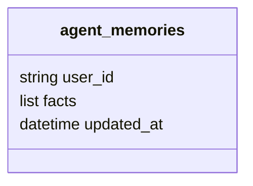

  

# Memória no MongoDB

O banco `assessor_inteligente` guarda checkpoints e fatos. O nome real dos fatos é `agent_memories`, conforme o repositório de memória, e não `user_memory` citado no README antigo.

O índice em `user_id` é único. A gravação substitui a lista de fatos por upsert. Não há TTL declarado para esses fatos. O `MongoDBSaver` usa `checkpoints_conversas` e `checkpoints_conversas_writes`, com TTL configurado em dias e convertido para segundos. O padrão é de trinta dias.

A biblioteca administra o formato serializado e seus índices. Mensagens e etapas enviadas ao `api-messenger` são dados de outro domínio. A política de compartilhamento com os demais agentes precisa de confirmação. <!-- PENDENTE: 2 -->
