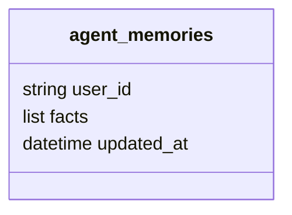

  

# Memória no MongoDB

O banco `assessor_inteligente` guarda checkpoints e fatos. O nome real dos fatos é `agent_memories`, conforme o repositório de memória, e não `user_memory` citado no README antigo.

O índice em `user_id` é único, e a gravação substitui a lista de fatos da pessoa por upsert, sem TTL declarado para esses fatos. O `MongoDBSaver` usa as coleções `checkpoints_conversas` e `checkpoints_conversas_writes`, com um TTL configurado em dias e convertido para segundos, que por padrão é de trinta dias.

A biblioteca administra o formato serializado e os seus índices, e as mensagens e etapas enviadas ao `api-messenger` pertencem a outro domínio. Cada agente é dono da própria coleção de memória, sem compartilhar fatos com os demais agentes, e a separação das coleções hoje compartilhadas está pendente.
