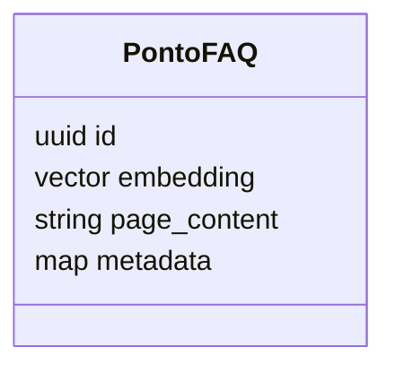

  

# Índice do FAQ

O [indexador](https://github.com/Solierrr/ai-assistant/blob/main/src/rag/vectorstore/qdrant_store.py) usa uma coleção vetorial de FAQ com distância cosseno. A dimensão é obtida do modelo de embeddings, sem número fixo no código.

O PDF é dividido em trechos de 500 caracteres com sobreposição de 50. Cada trecho recebe UUID determinístico por conteúdo. A ingestão faz upsert e remove pontos órfãos. Se nenhum trecho for extraído, aborta antes de limpar o índice. A recuperação exige coleção já populada e consulta três trechos por pergunta. A rotina de ingestão escreve e o especialista FAQ lê.
