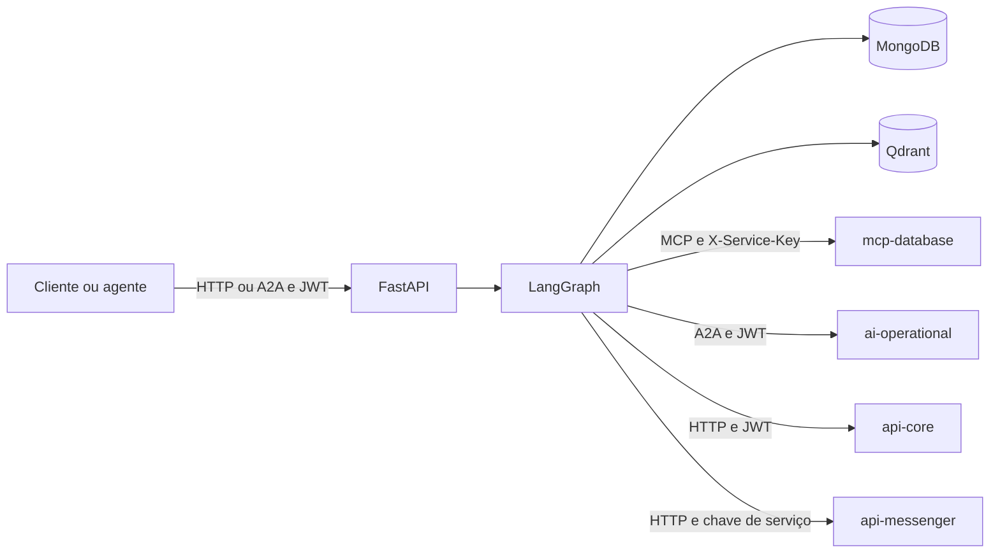

  

# Arquitetura

A aplicação FastAPI executa um grafo LangGraph. O [grafo](https://github.com/Solierrr/ai-assistant/blob/main/src/workflow/graph/graph.py) reúne guardrail de entrada, resumo, roteador, especialistas, orquestrador, juiz e guardrail de saída.

O código se divide entre `src/api/`, com as rotas e os schemas, `src/workflow/`, com a execução e a revisão das respostas, e `src/agents/`, com os especialistas e os prompts. Os clientes externos ficam em `src/infra/`, e `src/rag/` mantém a ingestão e a recuperação do FAQ.

| Integração | Uso |
|---|---|
| `api-auth` | Validação JWT por JWKS público |
| `mcp-database` | Ferramentas de recomendação com `X-Service-Key` e suporte a chave legada |
| `api-core` | Unidades da pessoa, com JWT |
| `api-messenger` | Conversas, mensagens e etapas |
| `ai-operational` | Delegação A2A com JWT e persona |
| Qdrant e provedores LLM | Recuperação vetorial e geração |

JWT e persona ficam no contexto da requisição, fora do estado persistido. O runner usa lock em memória por conversa e compara o dono salvo no checkpoint. A leitura desse dono, porém, continua em caso de erro no checkpoint. Essa limitação não deve ser confundida com isolamento entre réplicas.

A delegação operacional encerra o grafo diretamente, para preservar o texto da proposta, enquanto os demais especialistas voltam ao roteador. A memória e os índices estão descritos em `database/`, a versão vem de `version.txt`, o readiness confere o Mongo com limite de dois segundos e a telemetria registra etapas e custos, com rastreamento opcional.