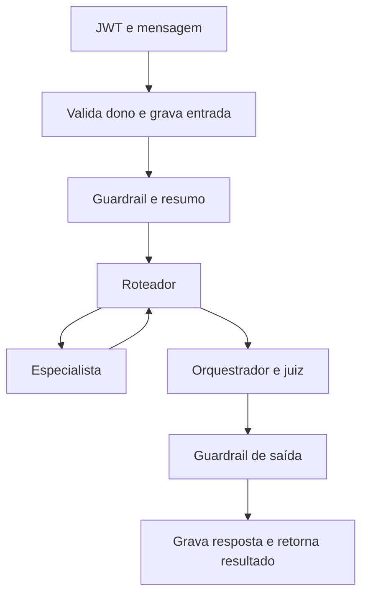

  

# Turno de atendimento

O turno valida acesso, recupera contexto e executa especialistas até produzir uma resposta. A interação completa está em [ASSISTANT_CHAT.md](https://github.com/Solierrr/docs-warehouse/blob/main/docs/flows/ASSISTANT_CHAT.md).

Token inválido, conversa de outra pessoa e corpo inválido impedem o turno. O FAQ e as ferramentas podem informar indisponibilidade. Falhas de atualização de fatos são registradas sem substituir a resposta.
