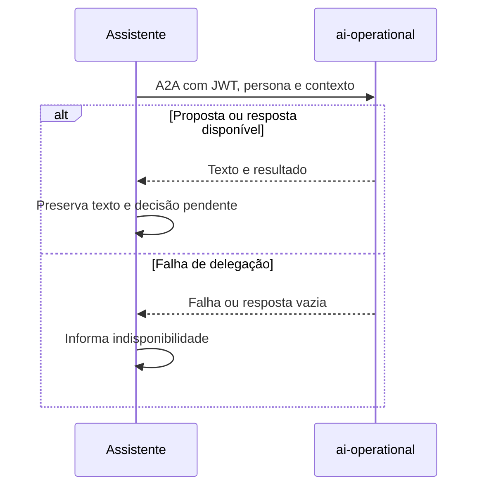

  

# Delegação operacional

O assistente encaminha um pedido de ação ao agente operacional preservando a identidade da pessoa.

A resposta não passa novamente pelo orquestrador ou juiz. Quando há decisão pendente, a próxima mensagem volta ao agente operacional. No debug sem persistência, a delegação é simulada.
