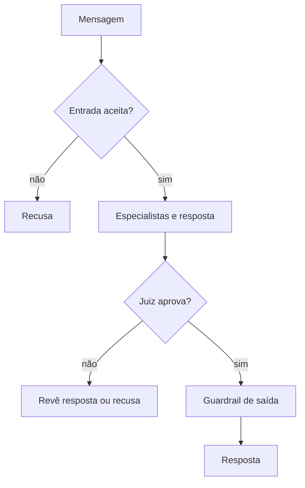

  

# Revisão da resposta

A revisão identifica pedidos fora do escopo, manipulação e dados internos, e confere a resposta antes de entregá-la.

A indisponibilidade do guardrail pode produzir resultado degradado. A recusa é expressa no resultado do turno e não equivale necessariamente a erro HTTP.
