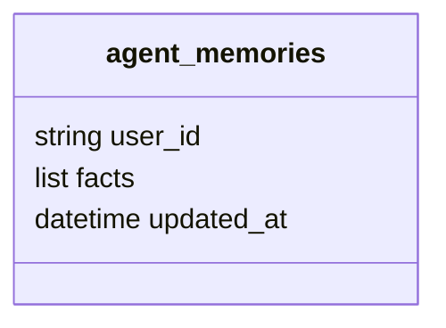

  

# Memória no MongoDB

O banco usado pelo código é `assessor_inteligente`. O [repositório de fatos](https://github.com/Solierrr/ai-geographic/blob/main/src/infra/database/mongo/repositories/user_memory_repository.py) lê e atualiza `agent_memories`.

A coleção tem índice único em `user_id`, e as gravações usam upsert, substituindo a lista de fatos da pessoa a cada atualização, sem TTL declarado para essa coleção.

O `MongoDBSaver` mantém `checkpoints_conversas` e `checkpoints_conversas_writes`, com a estrutura serializada e os índices administrados pela biblioteca `langgraph-checkpoint-mongodb`. O TTL é convertido de `CHECKPOINT_TTL_DIAS` para segundos, com padrão de trinta dias, e a criação tenta conectar três vezes antes de falhar. Cada agente é dono da própria coleção, sem compartilhar a memória com os demais, e a separação e a troca para nomes em inglês estão pendentes.
