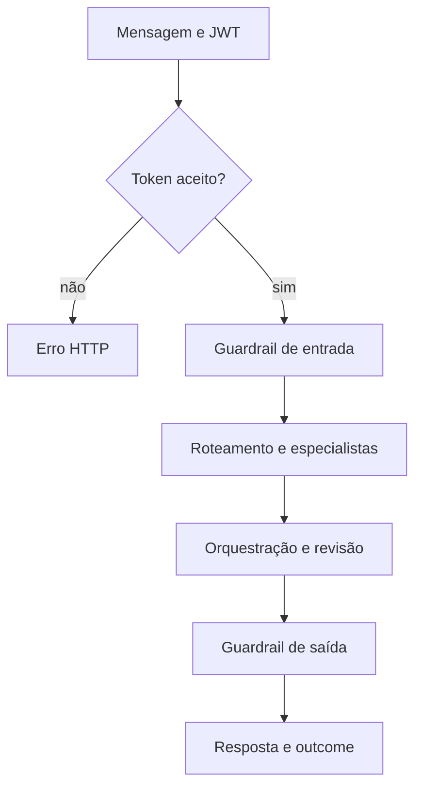

  

# Turno de conversa

O turno começa com uma mensagem autenticada e termina com uma resposta e a classificação do resultado. A conversa entre agentes se relaciona ao [fluxo central](https://github.com/Solierrr/docs-warehouse/blob/main/docs/flows/ASSISTANT_CHAT.md).

Token inválido produz 401. Corpo inválido produz 422. Falhas de ferramentas ou fallback de modelo são registradas no resultado do turno. O Mongo mantém checkpoints e o histórico é enviado ao serviço de mensagens.
