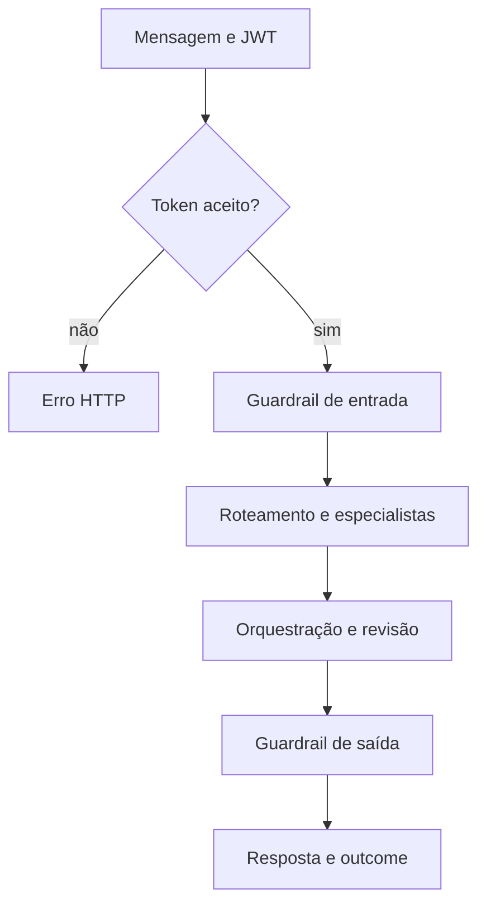

  

# Turno de conversa

O turno começa com uma mensagem autenticada e termina com uma resposta e a classificação do resultado. A conversa entre agentes se relaciona ao [fluxo central](https://github.com/Solierrr/docs-warehouse/blob/main/docs/flows/ASSISTANT_CHAT.md).

Um token inválido produz 401 e um corpo inválido produz 422, enquanto as falhas de ferramentas e a troca de modelo por alternativa ficam registradas no resultado do turno. O Mongo mantém os checkpoints da conversa, e o histórico é enviado ao serviço de mensagens.