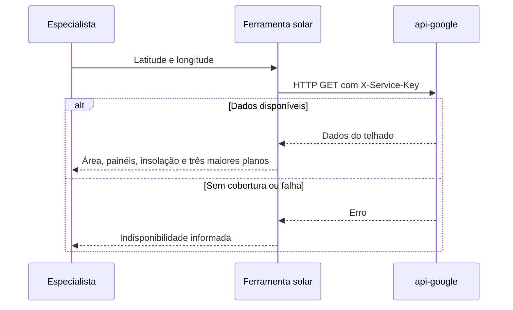

  

# Consulta solar

A consulta usa coordenadas para buscar o telhado mais próximo e resumir a estimativa de imagem.

O timeout é de vinte segundos. A falta de cobertura retorna uma informação ao especialista. Outras falhas de HTTP registram `SOLAR_DATA_UNAVAILABLE`.
