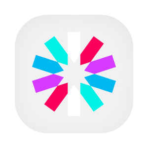

  

  
  
  
  
  
  

# Assistente de operações

Este serviço orienta fornecedores, compradores e administradores no uso da plataforma. A pessoa pode pedir instruções, localizar uma tela e consultar suas ofertas, seu estoque, seus pedidos, suas vendas e sua assinatura. Quando quer alterar algo, recebe uma proposta com os dados que serão usados. A alteração depende de uma confirmação posterior, e a pessoa pode recusar ou ajustar o pedido antes da execução.

O assistente principal delega as tarefas operacionais a este serviço. A conversa é processada com FastAPI e LangGraph, usa JWT para preservar as permissões da pessoa e consulta o cadastro central. O MongoDB guarda o estado das conversas e as preferências aprendidas. O serviço de mensagens recebe o histórico e os registros das etapas de execução.

## Aprofunde-se no Projeto!

- [OVERVIEW.md](./docs/OVERVIEW.md), capacidades e regras das operações.
- [ARCHITECTURE.md](./docs/ARCHITECTURE.md), componentes, integrações, memória e observabilidade.
- [RUNNING.md](./docs/RUNNING.md), configuração e execução local.
- [API.md](./docs/API.md), contrato HTTP e delegação A2A.
- [DEPLOY.md](./docs/DEPLOY.md), ambientes e publicação.
- [STATUS.md](./docs/STATUS.md), funcionalidades e limitações verificadas.
- [Fluxos](./flows/), delegação, consultas e aprovação de alterações.
- [Banco de dados](./database/), memória persistida e responsabilidades.
- [PENDENCIAS.md](./PENDENCIAS.md), decisões que precisam da resposta do responsável.

## Contribuindo

- [CONTRIBUTING.md](https://github.com/Solierrr/.github/blob/main/.github/CONTRIBUTING.md), convenções de commit, branch e Pull Request.
- [CODE_OF_CONDUCT.md](https://github.com/Solierrr/.github/blob/main/CODE_OF_CONDUCT.md), código de conduta.
- [SECURITY.md](https://github.com/Solierrr/.github/blob/main/SECURITY.md), como reportar uma vulnerabilidade.
