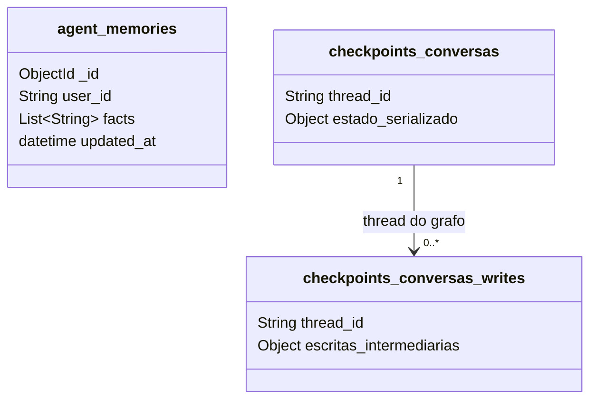

  

# Memória no MongoDB

O serviço lê e escreve no banco `assessor_inteligente`, por meio de `MONGO_URI` ou de sua alternativa `MONGODB_URI`. O código fixa o nome do banco. A URI não seleciona outro nome para essas operações.

O checklist previa a ausência de banco próprio, mas o checkpointer e o repositório de memória persistem dados diretamente, e este documento cobre esse uso. Cada agente é dono da própria coleção de memória, e os fatos duráveis ficam guardados até a exclusão da conta.

As duas coleções de checkpoint são administradas por `MongoDBSaver`. `estado_serializado` e `escritas_intermediarias` no diagrama representam o conteúdo lógico, não campos literais do driver. O formato BSON e os índices internos pertencem à versão instalada de `langgraph-checkpoint-mongodb`, que não está fixada em `requirements.txt`.

## Fatos duráveis

[`UserMemorySchema`](https://github.com/Solierrr/ai-operational/blob/main/src/infra/database/mongo/schemas/user_memory_schema.py) define `user_id`, `facts` e `updated_at`. O repositório usa `find_one` por pessoa e `update_one` com `upsert`, substituindo a lista inteira de fatos. O `_id` é gerado pelo MongoDB.

O lifespan cria índice único em `user_id`. Não há TTL, versão de documento ou identificação do agente nessa coleção. O runner lê antes do turno e agenda a atualização depois da resposta. A extração mantém no máximo vinte linhas de fatos.

O banco e a coleção ainda aparecem no contexto compartilhado dos agentes, e com a mesma URI a chave somente por pessoa permite que um grafo sobrescreva os fatos de outro. A regra definida é que cada agente tenha a sua coleção, e essa separação está pendente.

## Checkpoints

[`create_mongo_checkpointer`](https://github.com/Solierrr/ai-operational/blob/main/src/memory/session/mongo_checkpointer.py) cria `MongoDBSaver` com `checkpoints_conversas` e `checkpoints_conversas_writes`. O parâmetro TTL recebe `CHECKPOINT_TTL_DIAS` convertido para segundos, com retenção padrão de trinta dias. Índices de chave e expiração são delegados à biblioteca.

O estado inclui mensagens, resumo, dono, especialistas percorridos, proposta pendente e contador de gravações. A thread normal recebe `operational:<conversation_id>`. O debug recebe `operational:debug::<conversation_id>`. O namespace separa os checkpoints dos usados pelo assistente principal, mesmo quando a coleção é a mesma.

O checkpointer usa um cliente síncrono, e a memória durável e o readiness usam um cliente assíncrono, todos apontando para a mesma configuração de conexão. A criação do saver tenta de novo quando falha a seleção do servidor, em até três tentativas.

## Quem lê e escreve

O grafo lê e grava checkpoints para retomar o contexto. O replay de debug lê um estado anterior, usa uma cópia temporária e a remove ao concluir. O runner lê e atualiza `agent_memories`. No debug, não lê nem atualiza os fatos duráveis.

Conversas, mensagens e etapas enviadas ao `api-messenger` pertencem ao armazenamento daquele serviço. As constantes `conversations`, `messages`, `ai_logs`, `agent_executions`, `rag_documents` e `hallucination_reviews` existem no módulo de coleções, mas não têm leitura ou gravação ativa neste repositório. Não representam coleções geridas por este fluxo.

Não há coleção Qdrant nem persistência ativa no Redis neste grafo, e o backup e o acesso administrativo seguem a operação do banco de agentes.
