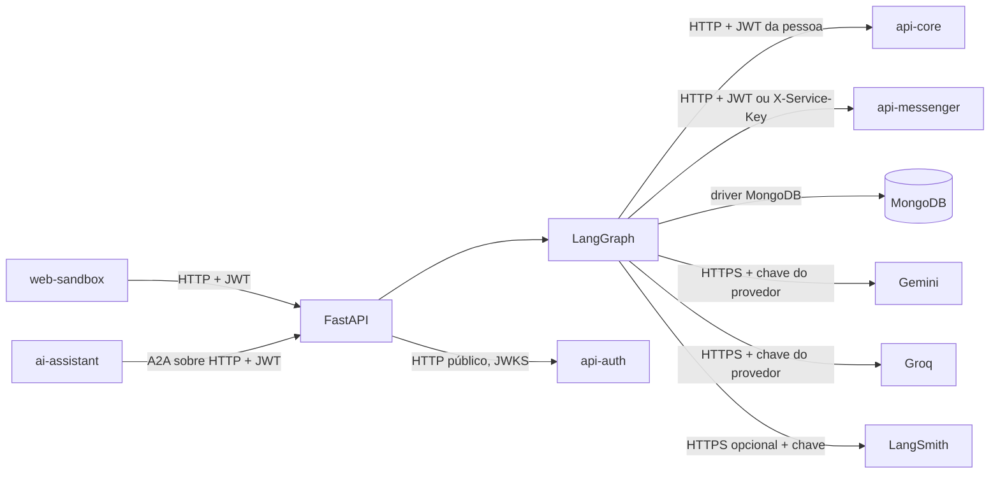

  

# Arquitetura

A API FastAPI atende turnos HTTP e delegações A2A. O LangGraph aplica o guardrail de entrada, resume o histórico e escolhe especialistas. Consultas e instruções passam pela composição e revisão da resposta. Propostas e resultados de ações encerram o grafo diretamente, para preservar o texto montado com os campos validados.

## Organização do código

As responsabilidades ficam separadas entre entrada, execução e acesso aos serviços.

| Caminho | Papel |
|---|---|
| `src/api/` | rotas, schemas, erros HTTP e health checks |
| `src/a2a/` | Agent Card e adaptação da delegação para um turno |
| `src/workflow/graph/`, `nodes/`, `edges/` | grafo, especialistas e decisões de caminho |
| `src/workflow/runner.py` | contexto de autenticação, bloqueio por conversa e histórico |
| `src/actions/` | registro de ações, rascunhos, propostas assinadas e execução |
| `src/agents/` | prompts e construção dos agentes |
| `src/domain/`, `src/tools/` | catálogo de telas, guias e ferramentas de consulta |
| `src/infra/` | clientes HTTP, MongoDB, MCP e Redis |
| `src/memory/` | checkpointer do LangGraph |
| `src/core/` | configuração, JWT, proteção de entrada e observabilidade |
| `tests/` | testes de API, ações, infraestrutura e workflow |

## Integrações

O código atual usa o `api-core` para dados operacionais. Os clientes MCP e Redis permanecem na infraestrutura, sem chamada no grafo ativo. O mapa central ainda descreve MCP como dependência da delegação. <!-- PENDENTE: 4 -->

| Com quem | Direção | Protocolo | Autenticação |
|---|---|---|---|
| `web-sandbox` | chama este serviço | HTTP em `/chat` e `/debug/chat` | JWT, com lista de administradores no debug |
| `ai-assistant` | chama este serviço | A2A sobre HTTP, montado pela biblioteca compartilhada | JWT da pessoa |
| `api-auth` | este serviço consulta | HTTP para JWKS | chave pública, validação local RS256 |
| `api-core` | este serviço chama | HTTP REST | JWT da pessoa, inclusive para gravações |
| `api-messenger` | este serviço chama | HTTP REST | JWT para conversa e mensagem da pessoa, `X-Service-Key` para resposta e observabilidade |
| Gemini e Groq | este serviço chama | HTTPS pelos SDKs de LLM | chave do provedor |
| LangSmith | este serviço envia traces opcionais | HTTPS | credencial própria |
| `mcp-database` | cliente presente, sem uso no grafo | MCP Streamable HTTP | `X-Service-Key`, com `x-api-key` legado se configurado |
| Redis | cliente presente, sem uso no grafo | Redis com TLS | usuário e senha |

O JWT no `api-core` preserva as permissões de quem pediu a operação. As chamadas internas ao serviço de mensagens seguem o [fluxo de autenticação entre serviços](https://github.com/Solierrr/docs-warehouse/blob/main/docs/flows/SERVICE_TO_SERVICE_AUTH.md).

## Grafo e decisões

O roteador escolhe `screen_finder`, `how_to_guide`, `data_reader` ou `action_proposer`. Cada especialista é consultado no máximo uma vez por turno, com limite de três especialistas. Os três primeiros voltam ao roteador. O orquestrador compõe a resposta, o juiz pode pedir revisão e o guardrail de saída filtra o texto.

Quando existe uma `pending_proposal`, o roteador envia a mensagem ao nó `proposal_decision`, que limpa a proposta e volta ao roteador se a pessoa pedir ajuste ou mudar de assunto, e encerra o turno no aceite ou na recusa. Os detalhes estão no [fluxo de aprovação](../flows/ACTION_APPROVAL.md).

O registro em [`src/actions/registry.py`](https://github.com/Solierrr/ai-operational/blob/main/src/actions/registry.py) limita as operações possíveis. Cada `ActionSpec` define schema, preparação, execução e resposta. O LLM extrai um rascunho, e a preparação resolve identificadores nas respostas do `api-core`. A proposta recebe HMAC-SHA256, dono e hora de criação. A assinatura usa `PROPOSAL_SIGNING_KEY`, depois `SERVICE_KEY` como alternativa e, sem ambas, uma chave aleatória do processo.

O aceite é reconhecido por frases normalizadas em `strict_decision`. O LLM pode classificar dúvida, recusa, ajuste ou outro assunto, mas não autoriza execução. Encerrar oferta e cancelar pedido exigem uma das fórmulas explícitas com "confirmo". O contador `writes_done` limita as gravações por conversa.

O guardrail de entrada limita o tamanho da mensagem e verifica padrões de manipulação e pedidos de dados internos antes da classificação por LLM. Textos externos passam por limpeza e entram nos prompts delimitados como dados. As ferramentas de conta são somente leitura. A escrita fica no nó de decisão, fora das ferramentas fornecidas ao modelo. O guardrail de saída remove links e padrões de segredos das respostas geradas, mas propostas e resultados usam seu próprio caminho de validação.

## Memória e histórico

O [MongoDB](../database/MONGO.md) guarda checkpoints e fatos por pessoa. A thread recebe o prefixo `operational:` para não colidir com o assistente principal. Com mais de cinco mensagens, o resumo incorpora as antigas e mantém as duas mais recentes no contexto ativo.

O runner cria a conversa no `api-messenger`, grava a mensagem da pessoa antes do grafo e a resposta depois dele. O vínculo entre thread e conversa remota fica em memória do processo. A extração de até vinte fatos acontece em background após a resposta. Uma falha nessa atualização é registrada sem desfazer o turno.

O `asyncio.Lock` serializa turnos da mesma conversa dentro do processo. Não há bloqueio distribuído. A leitura do dono do checkpoint recusa uma conversa de outra pessoa quando encontra o dono, mas uma exceção nessa leitura é registrada e permite continuar. Essas limitações estão em [STATUS.md](./STATUS.md).

## Observabilidade, health e versão

O `StepTracker` envia etapas e chamadas de LLM ao `api-messenger`. O custo por chamada é estimado com tokens e a tabela de `model_pricing.py`. Modelo sem preço e chamada com erro registram custo zero. O histórico enviado passa por anonimização de texto.

O tracing LangSmith é opcional, com amostragem e mascaramento de documentos, telefone, e-mail, JWT e chaves. Nomes e endereços não são mascarados. O tracing global do SDK recebe apenas um aviso de configuração e deve permanecer desligado para usar o caminho com mascaramento.

O OpenTelemetry instrumenta FastAPI, HTTPX, MongoDB e Redis a partir de `OTEL_EXPORTER_OTLP_ENDPOINT`, `SERVICE_VERSION`, `DEPLOYMENT_ENVIRONMENT` e `OTEL_TRACES_SAMPLING_PROBABILITY`, e pode ser desligado com `OTEL_SDK_DISABLED`. As respostas com um span válido levam o cabeçalho `X-Trace-Id`, e a exclusão automática de rastreamento cobre o `/health`, mas não o `/ready`.

O `/health` informa o processo e a versão, e o `/ready` faz apenas um `ping` no MongoDB com limite de dois segundos, sem mudar quando o modelo de linguagem ou o serviço de mensagens falham. O `version.txt` alimenta a API, o OpenAPI, o Agent Card e o health, enquanto a versão enviada à telemetria depende da configuração do ambiente.

A análise usa a main em [`d1a5e666`](https://github.com/Solierrr/ai-operational/commit/d1a5e666df853aba51ab49f190c7c0b631613b80), conferida em 2026-10-30.
