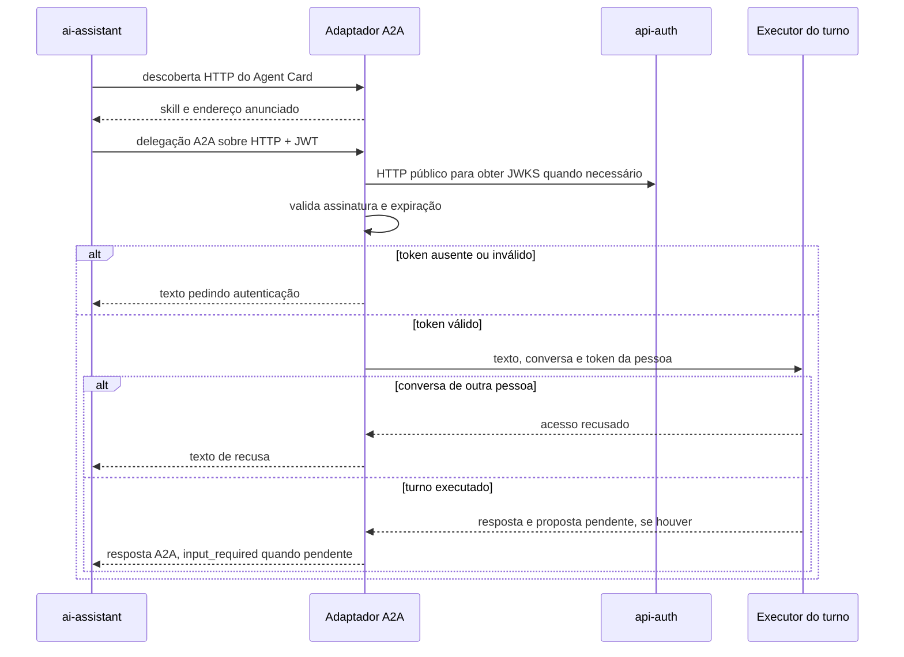

  

# Delegação operacional

O assistente principal delega um pedido operacional. O adaptador valida a identidade e executa o mesmo runner usado pelo chat HTTP. Uma proposta pendente devolve pedido de nova entrada, para que o chamador obtenha a decisão da pessoa.

O fluxo completo entre serviços está em [ASSISTANT_CHAT.md](https://github.com/Solierrr/docs-warehouse/blob/main/docs/flows/ASSISTANT_CHAT.md). A execução local das alterações está em [ACTION_APPROVAL.md](./ACTION_APPROVAL.md).

## Casos de erro

O handler trata ausência ou falha do token e conversa com dono diferente como texto de resposta. Exceções não tratadas pelo handler são entregues à biblioteca A2A, que controla o resultado da tarefa. Indisponibilidade de MongoDB, histórico ou LLM pode impedir o turno. O chamador deve manter o contexto da tarefa para a resposta de aprovação continuar a mesma conversa.
