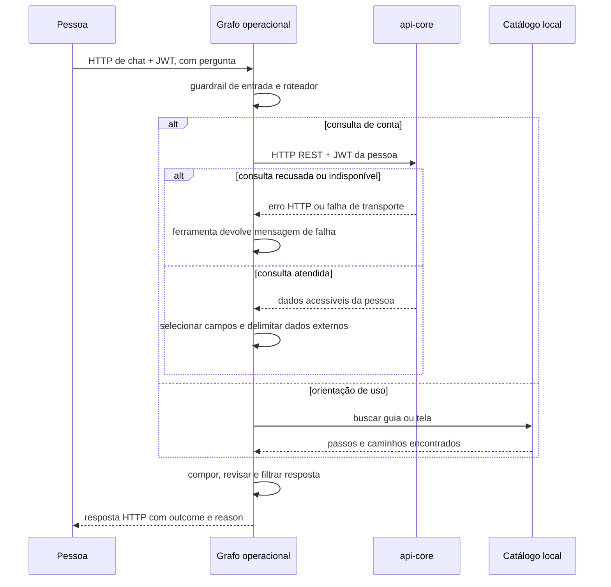

  

# Consulta e orientação

A pessoa pede seus dados ou uma instrução de uso. O roteador escolhe consulta de conta, guia ou localização de tela. Consultas usam o JWT da pessoa, enquanto guias e telas vêm dos catálogos do próprio serviço.

As listagens de conta mostram até quinze registros por ferramenta. O total retornado permite informar que a lista foi reduzida. Essas consultas não alteram dados. A ampliação documentada aqui usa HTTP direto, embora o [fluxo central](https://github.com/Solierrr/docs-warehouse/blob/main/docs/flows/ASSISTANT_CHAT.md) ainda cite ferramentas MCP. <!-- PENDENTE: 4 -->

## Casos de erro

- Sem token no contexto, a ferramenta devolve mensagem de falta de autenticação.
- Permissão negada, recurso ausente e indisponibilidade do cadastro central viram mensagens da ferramenta. Nem toda falha de consulta é marcada como `TOOL_FAILED`.
- Guia ou tela sem correspondência não autoriza inventar uma operação. O catálogo estático precisa de validação com a interface final. <!-- PENDENTE: 5 -->
- Recusa de entrada encerra o fluxo antes da consulta. O juiz pode rejeitar a resposta composta.
- Falha do histórico remoto ou do provedor pode impedir a resposta, mesmo com MongoDB pronto.
