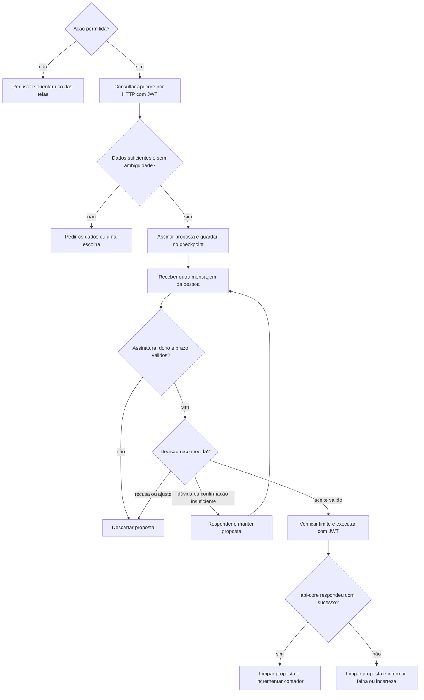

  

# Proposta e aprovação

O fluxo começa quando a pessoa pede uma alteração permitida. A preparação consulta os dados acessíveis, monta a proposta e aguarda outra mensagem. A gravação só ocorre após validação da proposta e aceite reconhecido pelo código.

Para ações comuns, "sim" é uma das fórmulas aceitas. Encerrar oferta e cancelar pedido exigem uma fórmula com "confirmo". O classificador LLM não pode produzir aceite. Ajuste e mudança de assunto voltam ao roteador depois de descartar a proposta. O debug substitui a escrita por uma resposta de simulação e limpa a proposta.

## Casos de erro

- Falta de modelo, preço, quantidade ou escolha impede formar a proposta.
- Ausência de fornecedor, catálogo sem correspondência ou vários candidatos produz pedido de esclarecimento.
- Proposta expirada, adulterada ou de outra pessoa é descartada.
- Oferta encerrada, quantidade negativa e pedido fora dos pagos não geram a alteração pretendida.
- Limite de gravações atingido limpa a proposta sem executar.
- Falha HTTP do cadastro central gera `TOOL_FAILED` com `ACTION_FAILED` e limpa a proposta.
- Falha de transporte não comprova se a alteração ocorreu. A resposta orienta conferir a tela antes de repetir.

O bloqueio por conversa vale apenas dentro do processo, e os riscos de concorrência que isso traz estão em [STATUS.md](../docs/STATUS.md). O percurso que leva o pedido até este serviço está em [ASSISTANT_CHAT.md](https://github.com/Solierrr/docs-warehouse/blob/main/docs/flows/ASSISTANT_CHAT.md).