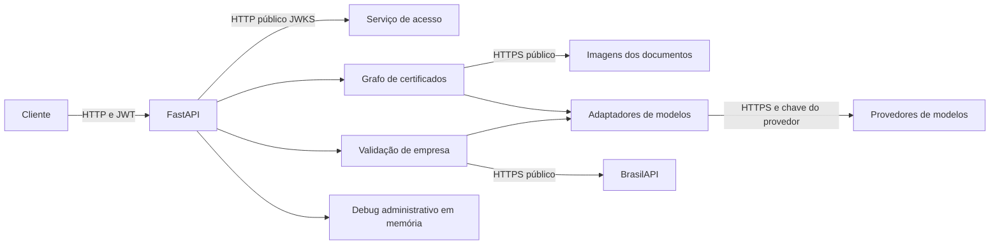

  

# Arquitetura

Serviço FastAPI com schemas Pydantic e um grafo LangGraph para certificados. O fluxo de empresas consulta BrasilAPI e um agente de texto. O código lê configurações de ambiente e reutiliza a biblioteca de modelos, sem banco de negócio próprio.

## Organização

| Caminho | Responsabilidade |
|---|---|
| `main.py` | Bootstrap, CORS, limites, erros, rotas e geração do OpenAPI |
| `src/api/` | Schemas, autenticação, rotas e respostas de erro |
| `src/workflow/` | Grafo, estado, extração, consolidação e depuração |
| `src/agents/specialist/` | Prompts e agente de empresa |
| `src/core/llm/` | Clientes e fallback de modelos |
| `src/core/config/` | Settings cacheadas |
| `src/services/` | Consulta BrasilAPI |
| `tests/` | Testes de rotas, nós, segurança e integrações isoladas |

## Integrações e autenticação

| Relação | Protocolo | Autenticação |
|---|---|---|
| Clientes chamam validação | HTTP JSON | JWT de usuário por padrão |
| Verificação de assinatura | HTTP JWKS | Chave pública, assinatura RS256 |
| Download de certificados | HTTP ou HTTPS | URL acessível, sem envio do JWT ao armazenamento |
| Consulta de CNPJ | HTTPS BrasilAPI | Sem credencial no cliente implementado |
| Modelos | HTTPS pelos adaptadores | Chaves de provedor do ambiente |
| Cadastro central pretende validar profissional | HTTP | Contrato ausente nesta main, sem integração ativa comprovada |

A dependência `require_access_token` protege os dois routers de negócio, e como `AUTH_REQUIRED` vem ligado por padrão, a falta de JWKS configurado responde 503. A validação exige `exp` e `sub`, aceita apenas RS256 e recusa `token_type` diferente de `access`, tratando o token como access quando o campo não existe, e confere o issuer quando ele está configurado.

A função `require_caller` e a variável `SERVICE_KEY_API_CORE` existem. Nenhuma rota de validação desta main usa essa dependência. Definir uma chave não cria a rota profissional nem substitui a autenticação JWT. <!-- PENDENTE: 1 -->

## Execução e dados

O grafo público é compilado sem checkpointer. Ele baixa as duas imagens, aplica segurança, executa os especialistas e consolida. Base64 e MIME são reutilizados no estado durante a solicitação. Falhas capturadas na leitura ou nos nós podem gerar reprovação de documento, enquanto exceções não tratadas viram erro HTTP.

O download segue redirecionamentos e usa timeout de 30 segundos. O código não declara limite de bytes ou restrição de origem. A política de imagens precisa ser definida antes de descrever essa entrada como restrita a um armazenamento aprovado. <!-- PENDENTE: 4 -->

O fallback externo só avança por erro reconhecido como rate limit. Chamadas de imagem excluem o provedor marcado como apenas texto. A biblioteca compartilhada também administra rodízio de chaves. Dependências instaladas não comprovam uso de PostgreSQL, MongoDB ou índice vetorial.

## Observabilidade, health e versão

Os logs saem em JSON, e o debug administrativo mostra as etapas e permite uma reexecução controlada, como descreve o [fluxo de depuração](../flows/DEBUG_REPLAY.md). O serviço não guarda dados de negócio, e tanto os limites quanto o debug valem só para a instância em execução.

O `/health` retorna o estado e a versão, e o `/ready` retorna só o estado, sem consultar a BrasilAPI, o JWKS ou os modelos, por isso uma resposta positiva não comprova que uma validação real será atendida.

A versão é lida de `version.txt`, hoje `3.1.0`, e a revisão analisada é a `7855fc9f`, de 2026-10-30. As fontes principais são o [bootstrap](https://github.com/Solierrr/ai-validation/blob/main/main.py), o [JWT](https://github.com/Solierrr/ai-validation/blob/main/src/core/security/jwt.py), o [grafo](https://github.com/Solierrr/ai-validation/blob/main/src/workflow/graph/graph.py), as [settings](https://github.com/Solierrr/ai-validation/blob/main/src/core/config/settings.py) e o [download](https://github.com/Solierrr/ai-validation/blob/main/src/workflow/nodes/security_guardrail_node.py).