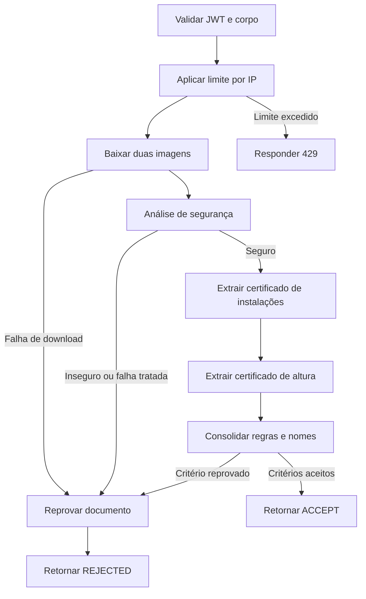

  

# Validação de certificados

A solicitação envia duas URLs e recebe a decisão consolidada, sem gravar aprovação no cadastro central.

## Falhas e limites

JWT inválido e corpo inválido impedem o fluxo. Download ou falha capturada de análise pode produzir reprovação em 200. Exceção não tratada do grafo responde 500. A consolidação usa 730 dias, cargas mínimas e similaridade, sem nova chamada a modelo.

Fonte em [implementação](https://github.com/Solierrr/ai-validation/blob/main/src/workflow/nodes/consolidation_node.py). O contexto entre serviços está no [mapa de integrações](https://github.com/Solierrr/docs-warehouse/blob/main/docs/flows/INTEGRATIONS.md).
