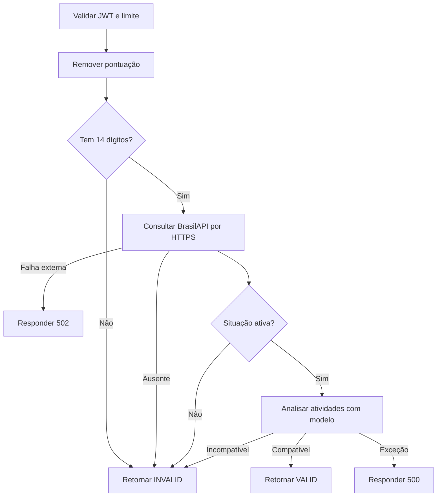

  

# Validação de empresa

A consulta verifica cadastro ativo antes de avaliar a compatibilidade das atividades.

## Falhas e limites

A consulta trata 400 e 404 como cadastro ausente. Para 429 tenta até três vezes, com esperas de 2, 4 e 8 segundos, e propaga a falha se esgotar. A consulta usa timeout de 15 segundos por requisição. A classificação do modelo não equivale a nova consulta cadastral.

Fonte em [implementação](https://github.com/Solierrr/ai-validation/blob/main/src/api/routes/cnpj_routes.py). O contexto entre serviços está no [mapa de integrações](https://github.com/Solierrr/docs-warehouse/blob/main/docs/flows/INTEGRATIONS.md).
