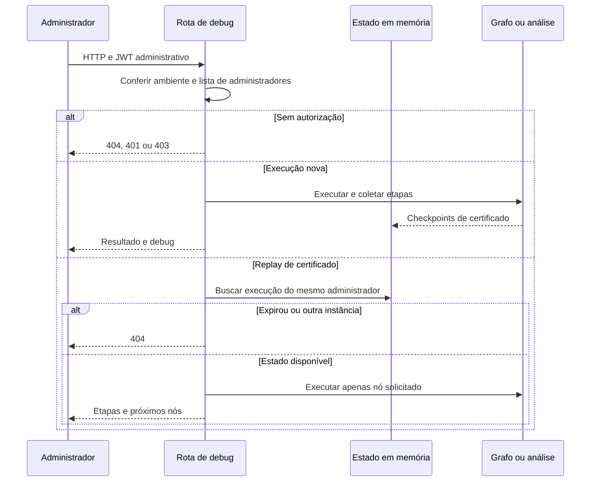

  

# Depuração administrativa

Um administrador consulta etapas ou reexecuta um nó sobre estado disponível na instância, sem alterar o fluxo público.

## Falhas e limites

O controle usa referência de cinco execuções, 30 minutos e 64 MiB estimados no conjunto, com descarte sob consulta ou inclusão. Não é retenção durável nem limite rígido para uma execução isolada. Replay de certificado aplica overrides de sistema e para após o nó. Empresa pode ter nova análise com prompts personalizados. Algumas falhas usam JSON próprio.

Fonte em [implementação](https://github.com/Solierrr/ai-validation/blob/main/src/api/routes/debug_routes.py). O contexto entre serviços está no [mapa de integrações](https://github.com/Solierrr/docs-warehouse/blob/main/docs/flows/INTEGRATIONS.md).
