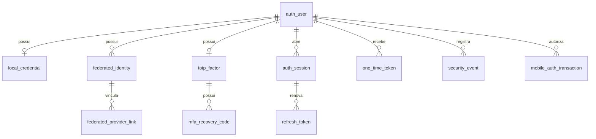

  

# PostgreSQL de autenticação

O serviço grava a identidade, as credenciais, as sessões, os tokens e a outbox, conforme as migrations [V1](https://github.com/Solierrr/api-auth/blob/main/src/main/resources/db/migration/V1__create_auth_schema.sql) e [V2](https://github.com/Solierrr/api-auth/blob/main/src/main/resources/db/migration/V2__mobile_authorization.sql), enquanto o cadastro de negócio pertence ao `api-core`.

## `auth_user`

Identidade, e-mail único sem distinção de caixa e bloqueio de acesso.

`id` (UUID), `primary_email` (CITEXT), `email_verified_at` (TIMESTAMPTZ), `status` (account_status), `failed_login_attempts` (INTEGER), `locked_until` (TIMESTAMPTZ), `last_login_at` (TIMESTAMPTZ), `created_at` (TIMESTAMPTZ), `updated_at` (TIMESTAMPTZ).

## `local_credential`

Hash da senha e datas de alteração.

`user_id` (UUID), `password_hash` (VARCHAR(255)), `password_changed_at` (TIMESTAMPTZ), `must_change` (BOOLEAN), `created_at` (TIMESTAMPTZ), `updated_at` (TIMESTAMPTZ).

## `federated_identity`

Identidade externa única por emissor e sujeito.

`id` (UUID), `user_id` (UUID), `authority` (VARCHAR(30)), `issuer` (TEXT), `subject` (TEXT), `email` (CITEXT), `email_verified` (BOOLEAN), `created_at` (TIMESTAMPTZ), `last_login_at` (TIMESTAMPTZ).

## `federated_provider_link`

Vínculo com Google ou Microsoft, limitado por constraints.

`id` (UUID), `federated_identity_id` (UUID), `provider` (VARCHAR(30)), `provider_subject` (TEXT), `email` (CITEXT), `linked_at` (TIMESTAMPTZ).

## `totp_factor`

Fator cifrado, com algoritmo, dígitos e contador. Não há rota pública de configuração.

`id` (UUID), `user_id` (UUID), `secret_ciphertext` (BYTEA), `secret_nonce` (BYTEA), `encryption_key_id` (VARCHAR(100)), `algorithm` (otp_algorithm), `digits` (SMALLINT), `period_seconds` (SMALLINT), `enabled_at` (TIMESTAMPTZ), `last_used_counter` (BIGINT), `created_at` (TIMESTAMPTZ), `updated_at` (TIMESTAMPTZ).

## `mfa_recovery_code`

Hashes dos códigos de recuperação.

`id` (UUID), `factor_id` (UUID), `code_hash` (VARCHAR(255)), `created_at` (TIMESTAMPTZ), `used_at` (TIMESTAMPTZ).

## `auth_session`

Sessões, validade, método de autenticação e revogação. V2 acrescenta `client_id` (VARCHAR(100)) e `context` (VARCHAR(30)), ambos obrigatórios.

`id` (UUID), `user_id` (UUID), `ip_address` (VARCHAR(45)), `user_agent` (TEXT), `device` (TEXT), `authentication_methods` (TEXT[]), `mfa_completed_at` (TIMESTAMPTZ), `created_at` (TIMESTAMPTZ), `last_access_at` (TIMESTAMPTZ), `expires_at` (TIMESTAMPTZ), `revoked_at` (TIMESTAMPTZ), `revocation_reason` (VARCHAR(60)).

## `refresh_token`

Hash único, consumo, substituição e revogação.

`id` (UUID), `session_id` (UUID), `token_hash` (BYTEA), `created_at` (TIMESTAMPTZ), `expires_at` (TIMESTAMPTZ), `consumed_at` (TIMESTAMPTZ), `revoked_at` (TIMESTAMPTZ), `replaced_by_id` (UUID).

## `one_time_token`

Hash único e validade para confirmação, recuperação e vínculo.

`id` (UUID), `user_id` (UUID), `type` (one_time_token_type), `token_hash` (BYTEA), `created_at` (TIMESTAMPTZ), `expires_at` (TIMESTAMPTZ), `consumed_at` (TIMESTAMPTZ).

## `security_event`

Auditoria de acesso com referência opcional a conta e sessão.

`id` (UUID), `user_id` (UUID), `session_id` (UUID), `event_type` (security_event_type), `succeeded` (BOOLEAN), `ip_address` (VARCHAR(45)), `user_agent` (TEXT), `details` (JSONB), `occurred_at` (TIMESTAMPTZ).

## `outbox_event`

Eventos pendentes, payload e tentativas de publicação.

`id` (UUID), `aggregate_type` (VARCHAR(60)), `aggregate_id` (UUID), `event_type` (VARCHAR(100)), `payload` (JSONB), `created_at` (TIMESTAMPTZ), `published_at` (TIMESTAMPTZ), `attempts` (INTEGER).

## `mobile_auth_transaction`

Transação PKCE com desafio, destino, estado, código e consumo.

`id` (VARCHAR(43)), `client_id` (VARCHAR(100)), `redirect_uri` (TEXT), `state` (VARCHAR(128)), `code_challenge` (VARCHAR(43)), `status` (VARCHAR(30)), `expires_at` (TIMESTAMPTZ), `user_id` (UUID), `authorizing_session_id` (UUID), `code_hash` (BYTEA), `code_expires_at` (TIMESTAMPTZ), `consumed_at` (TIMESTAMPTZ).

## Índices e integridade

- `idx_auth_session_user_active`.
- `idx_refresh_token_session`.
- `idx_one_time_token_user_type`.
- `idx_security_event_user_occurred`.
- `idx_outbox_event_pending`.
- `idx_mobile_transaction_expiry`.

As unicidades de e-mail, identidade federada, hash de token e fator por usuário também criam índices. Credenciais, fatores, tokens e sessões dependem da conta com remoção em cascata. Eventos de segurança usam referências anuláveis. O vínculo do refresh anterior ao substituto usa `ON DELETE SET NULL`.
