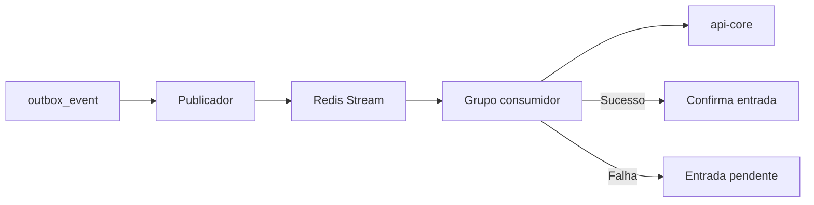

  

# Redis de outbox

O PostgreSQL mantém os eventos de origem em `outbox_event`. O publicador envia registros para Redis Streams e o consumidor do próprio serviço chama o cadastro central.

A stream transporta tipo de evento e payload. `USER_REGISTERED` contém o identificador de autenticação. Outros eventos são confirmados sem provisionamento por esse consumidor. O reclaimer trata entradas pendentes conforme as propriedades da outbox. Os nomes e parâmetros operacionais são configurados em `OutboxProperties`. Redis não participa do readiness da aplicação.
