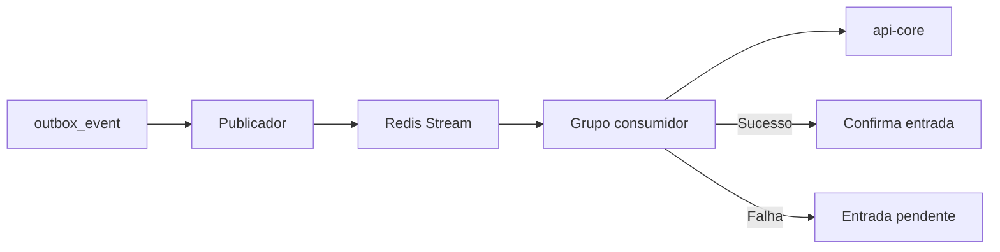

  

# Redis de outbox

O PostgreSQL mantém os eventos de origem em `outbox_event`. O publicador envia registros para Redis Streams e o consumidor do próprio serviço chama o cadastro central.

A stream transporta o tipo do evento e o payload, e o `USER_REGISTERED` leva o identificador de autenticação, enquanto os outros eventos são confirmados por este consumidor sem provisionar nada. O reclaimer trata as entradas pendentes conforme as propriedades da outbox, configuradas em `OutboxProperties`, e o Redis não participa do readiness da aplicação.