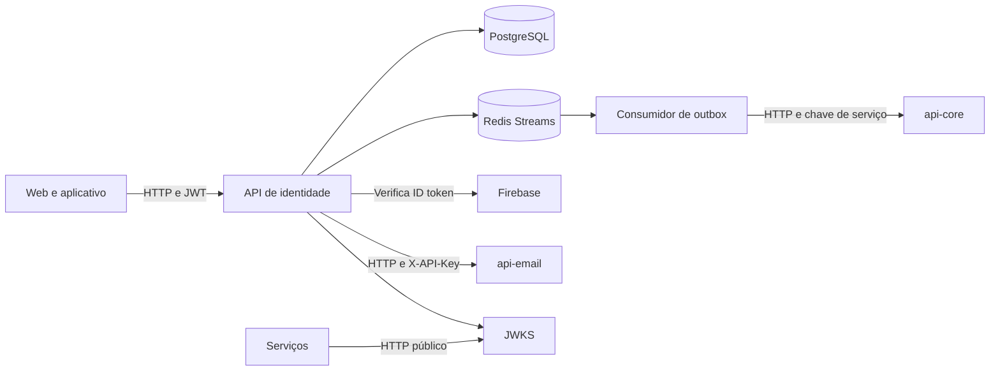

  

# Arquitetura

Aplicação Kotlin com Spring Boot, JPA, PostgreSQL, Redis Streams e validação de identidade por Firebase. Controllers ficam em `controller/` e `mobile/`, regras em `service/`, persistência em `repository/` e integrações em `integration/`.

O [consumidor](https://github.com/Solierrr/api-auth/blob/main/src/main/kotlin/com/solaria/auth/outbox/consumer/UserRegisteredEventListener.kt) pertence a este serviço e chama o `api-core`, confirmando o evento só depois do processamento, de modo que uma falha deixa a entrada pendente para uma nova tentativa.

| Integração | Autenticação |
|---|---|
| Clientes | Senha ou prova Firebase para login, JWT para operações de conta |
| `api-core` | Chave configurada no cliente HTTP |
| `api-email` | `X-API-Key`, divergente do padrão atual de `X-Service-Key` |
| Consumidores do JWKS | Consulta pública para obter chave de validação |
| Rotas `/internal/**` | Liberadas na configuração de segurança, sem filtro de chave de serviço nesta main |

As rotas internas devem exigir a `X-Service-Key` de cada chamador, sem depender só do gateway. Os dados estão em [POSTGRES.md](../database/POSTGRES.md) e [REDIS.md](../database/REDIS.md).

As senhas usam BCrypt com custo 12, os access tokens duram quinze minutos por padrão e os refresh tokens aleatórios duram sete dias, guardados por hash e trocados a cada uso, com a sessão revogada quando um deles é reutilizado. O readiness considera o PostgreSQL e deixa de fora o Redis e o e-mail, o Actuator expõe health e info, e a telemetria usa OpenTelemetry.