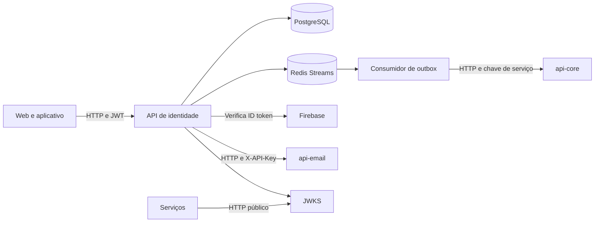

  

# Arquitetura

Aplicação Kotlin com Spring Boot, JPA, PostgreSQL, Redis Streams e validação de identidade por Firebase. Controllers ficam em `controller/` e `mobile/`, regras em `service/`, persistência em `repository/` e integrações em `integration/`.

O [consumidor](https://github.com/Solierrr/api-auth/blob/main/src/main/kotlin/com/solaria/auth/outbox/consumer/UserRegisteredEventListener.kt) é deste serviço e chama o `api-core`. O evento só é confirmado após o processamento. Falhas deixam a entrada pendente para retry.

| Integração | Autenticação |
|---|---|
| Clientes | Senha ou prova Firebase para login, JWT para operações de conta |
| `api-core` | Chave configurada no cliente HTTP |
| `api-email` | `X-API-Key`, divergente do padrão atual de `X-Service-Key` |
| Consumidores do JWKS | Consulta pública para obter chave de validação |
| Rotas `/internal/**` | Liberadas na configuração de segurança, sem filtro de chave de serviço nesta main |

A autenticação interna precisa de decisão de implantação. <!-- PENDENTE: 2 --> Os dados estão em [POSTGRES.md](../database/POSTGRES.md) e [REDIS.md](../database/REDIS.md).

Senhas usam BCrypt com custo 12. Access tokens têm duração configurável com padrão de quinze minutos. Refresh tokens aleatórios duram sete dias por padrão, são armazenados por hash e rotacionados. Reuso revoga a sessão. O readiness considera PostgreSQL e exclui Redis e e-mail. O Actuator expõe health e info, e a telemetria usa OpenTelemetry.
