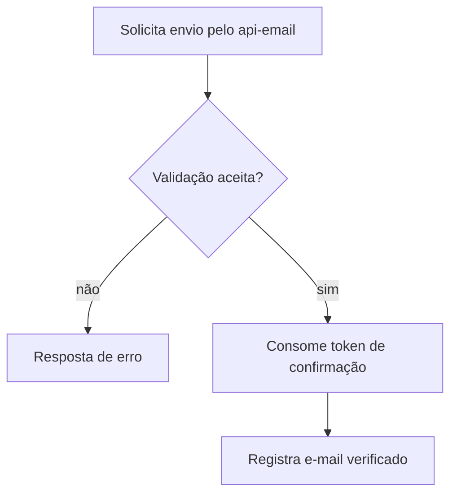

  

# Confirmação de e-mail

A pessoa autenticada pede a mensagem e usa o link para confirmar o endereço. O contexto entre serviços está em [login e tokens](https://github.com/Solierrr/docs-warehouse/blob/main/docs/flows/LOGIN_AND_TOKEN.md) e [provisionamento](https://github.com/Solierrr/docs-warehouse/blob/main/docs/flows/USER_PROVISIONING.md).

Token inválido, consumido ou expirado é recusado. O prazo de confirmação é de vinte e quatro horas.
