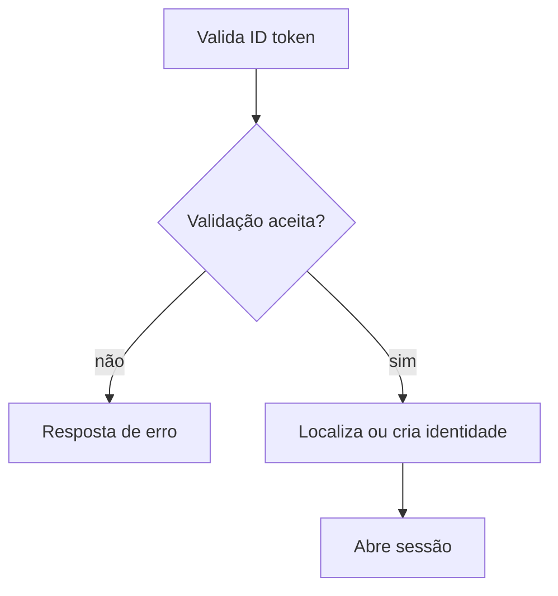

  

# Entrada federada

O serviço valida a prova do Firebase e usa a identidade por emissor e sujeito. O contexto entre serviços está em [login e tokens](https://github.com/Solierrr/docs-warehouse/blob/main/docs/flows/LOGIN_AND_TOKEN.md) e [provisionamento](https://github.com/Solierrr/docs-warehouse/blob/main/docs/flows/USER_PROVISIONING.md).

E-mail precisa estar verificado. Uma conta local com o mesmo e-mail exige vínculo e prova da senha.
