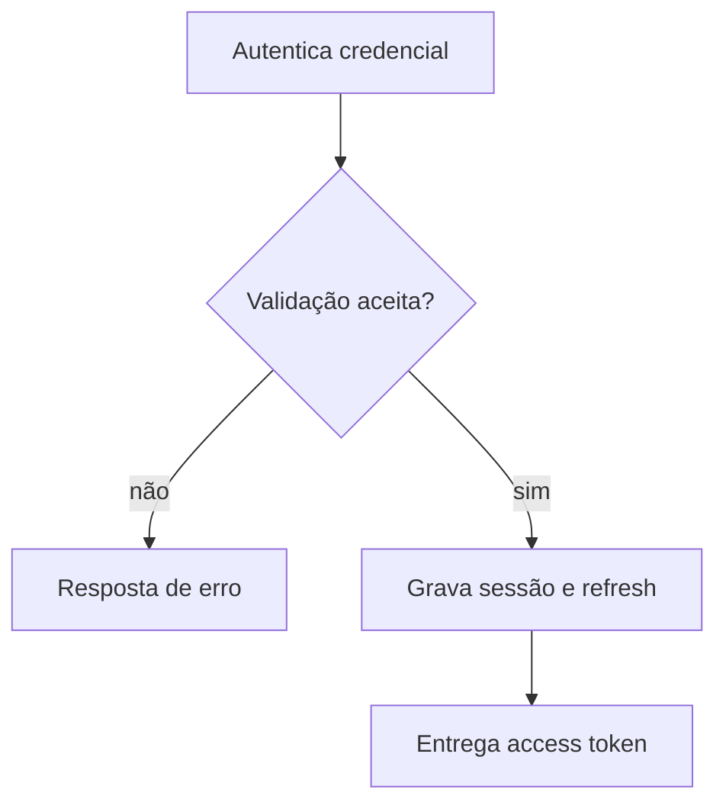

  

# Entrada com senha

O login valida a senha, registra a tentativa e abre uma sessão. O contexto entre serviços está em [login e tokens](https://github.com/Solierrr/docs-warehouse/blob/main/docs/flows/LOGIN_AND_TOKEN.md) e [provisionamento](https://github.com/Solierrr/docs-warehouse/blob/main/docs/flows/USER_PROVISIONING.md).

Falha de credencial é registrada. Cinco falhas bloqueiam a conta por quinze minutos.
