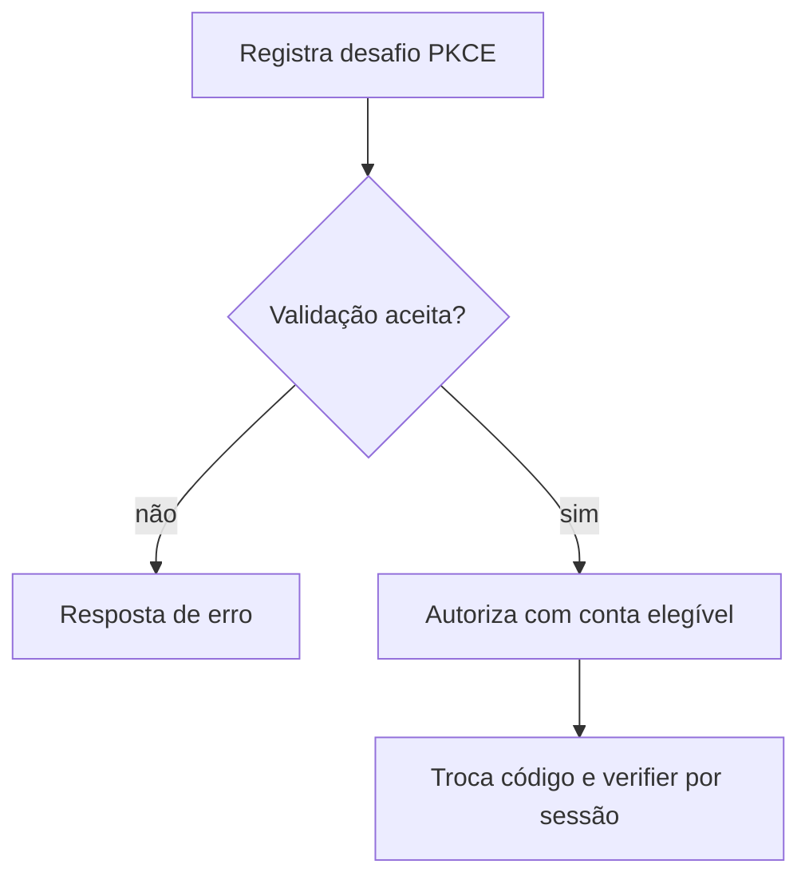

  

# Autorização mobile

O aplicativo inicia uma transação e abre o consentimento na sessão web. O contexto entre serviços está em [login e tokens](https://github.com/Solierrr/docs-warehouse/blob/main/docs/flows/LOGIN_AND_TOKEN.md) e [provisionamento](https://github.com/Solierrr/docs-warehouse/blob/main/docs/flows/USER_PROVISIONING.md).

São conferidos cliente, redirect, sessão web, validade, consumo único e desafio S256. E-mail não verificado e inelegibilidade bloqueiam a autorização.
