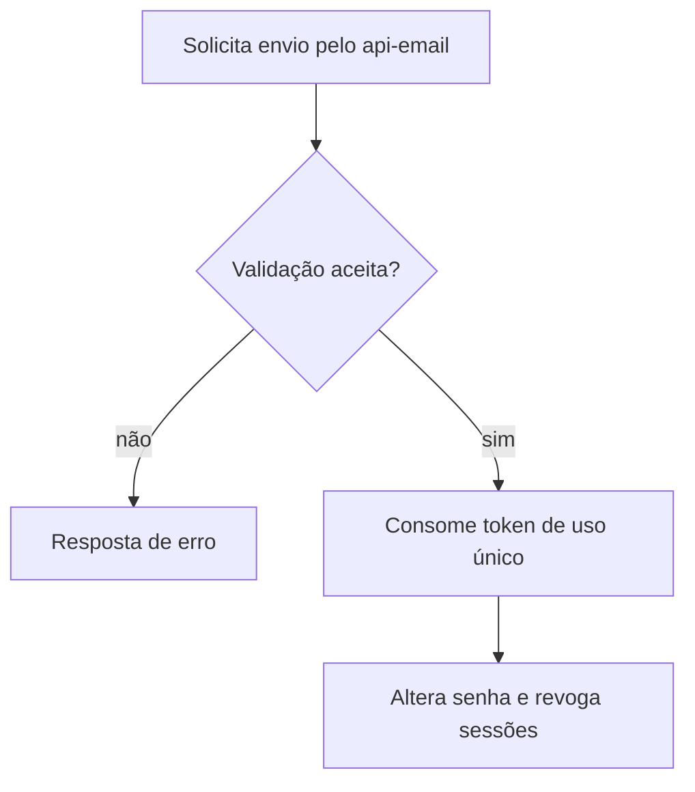

  

# Recuperação de senha

A solicitação de recuperação não revela se uma conta existe. O contexto entre serviços está em [login e tokens](https://github.com/Solierrr/docs-warehouse/blob/main/docs/flows/LOGIN_AND_TOKEN.md) e [provisionamento](https://github.com/Solierrr/docs-warehouse/blob/main/docs/flows/USER_PROVISIONING.md).

O token expira em trinta minutos. Transporte ausente produz EMAIL_NOT_CONFIGURED e falha no envio produz EMAIL_UNAVAILABLE.
