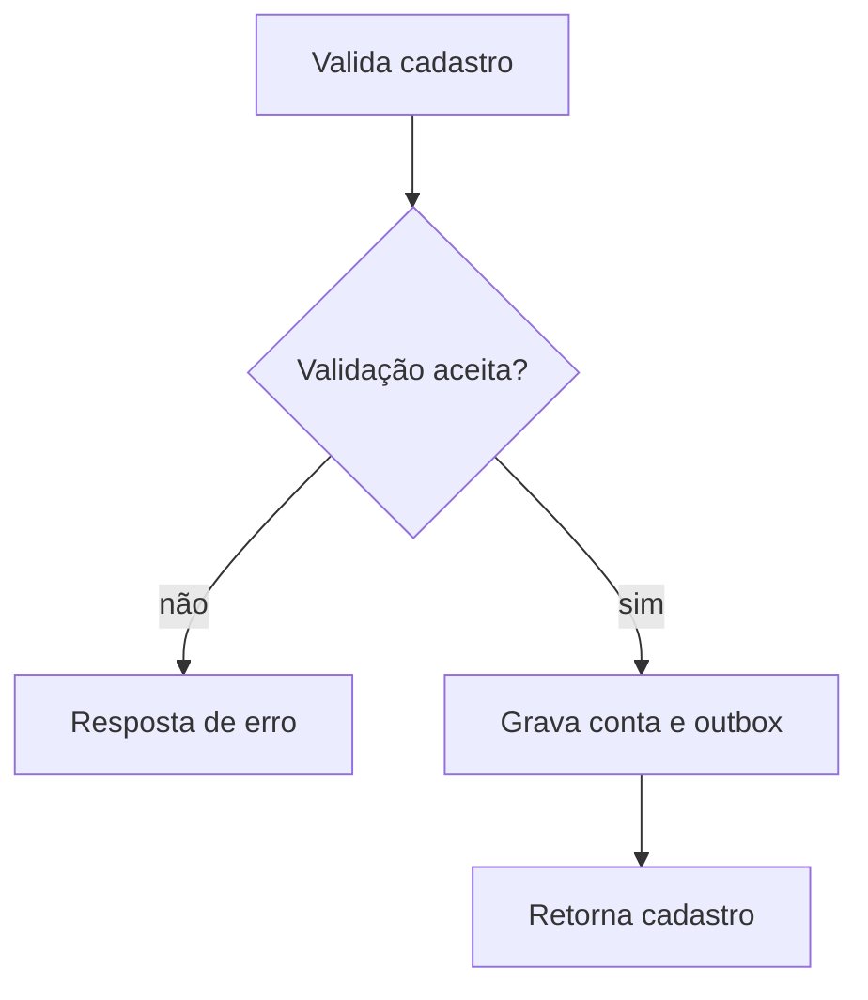

  

# Cadastro

A pessoa informa e-mail e senha. O serviço cria a identidade e grava o evento de provisionamento na mesma transação. O contexto entre serviços está em [login e tokens](https://github.com/Solierrr/docs-warehouse/blob/main/docs/flows/LOGIN_AND_TOKEN.md) e [provisionamento](https://github.com/Solierrr/docs-warehouse/blob/main/docs/flows/USER_PROVISIONING.md).

E-mail já existente ou entrada inválida impedem o cadastro. O provisionamento do cadastro de negócio é assíncrono.
