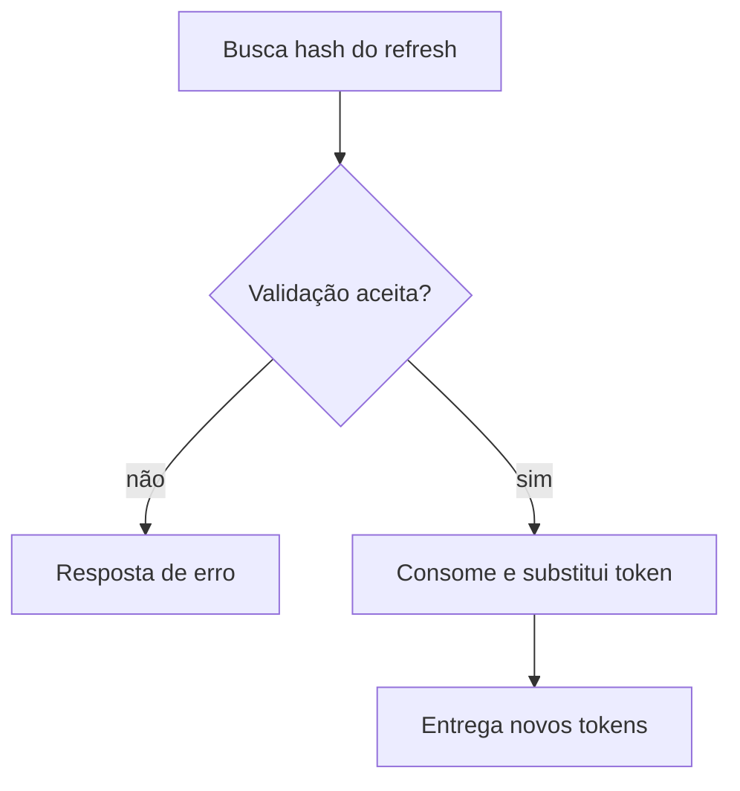

  

# Renovação de sessão

O cliente apresenta o refresh anterior para receber outro e um novo access token. O contexto entre serviços está em [login e tokens](https://github.com/Solierrr/docs-warehouse/blob/main/docs/flows/LOGIN_AND_TOKEN.md) e [provisionamento](https://github.com/Solierrr/docs-warehouse/blob/main/docs/flows/USER_PROVISIONING.md).

Reuso de token consumido revoga a sessão. Sessão revogada ou expirada impede renovação.
