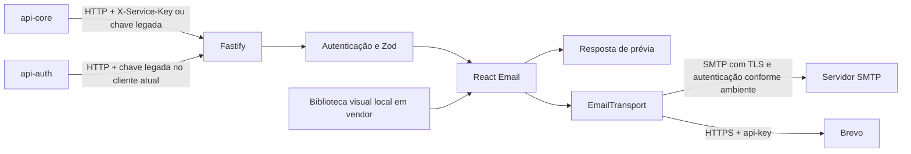

  

# Arquitetura

A API usa Node.js 24 e TypeScript com Fastify. As duas rotas de e-mail compartilham autenticação e validação Zod. React Email gera HTML e texto simples. A interface `EmailTransport` separa a renderização do envio, com implementações SMTP por Nodemailer e HTTPS para Brevo.

## Arquivos

Os módulos separam configuração, contrato, apresentação e entrega ao transporte.

| Caminho                          | Papel                                                   |
| -------------------------------- | ------------------------------------------------------- |
| `src/config/config.ts`           | valida ambiente, chaves, remetente e origens permitidas |
| `src/config/smtp.ts`, `brevo.ts` | criação e verificação dos transportes                   |
| `src/http/`                      | OpenAPI, ProblemDetail e guarda de chave de serviço     |
| `src/email/email.schema.ts`      | corpo estrito e regras de links e modelos               |
| `src/email/email.routes.ts`      | prévia, envio e conversão de falhas                     |
| `src/email/email.service.tsx`    | renderização e chamada ao transporte                    |
| `src/email/templates/`           | composição e textos nos três idiomas                    |
| `src/email/components/`          | cartões de detalhes e imagem incorporada de referência  |
| `src/app.ts`, `server.ts`        | aplicação injetável para testes, health e shutdown      |
| `vendor/`                        | pacote local da biblioteca visual compartilhada         |
| `http/`, `assets/mocks/`         | coleção Bruno e payloads de demonstração                |

## Integrações

O serviço não valida JWT de pessoas nem consulta cadastros para escolher destinatários.

| Com quem      | Direção                                 | Protocolo         | Autenticação                                                    |
| ------------- | --------------------------------------- | ----------------- | --------------------------------------------------------------- |
| `api-core`    | chama este serviço                      | HTTP em `/emails` | chave de serviço e cabeçalho legado presentes no worker atual   |
| `api-auth`    | cliente implementado chama este serviço | HTTP em `/emails` | cliente atual ainda envia `X-API-Key`                           |
| SMTP          | este serviço chama quando selecionado   | SMTP              | credenciais opcionais, TLS obrigatório fora de desenvolvimento  |
| Brevo         | este serviço chama quando selecionado   | HTTPS             | `BREVO_API_KEY` no cabeçalho `api-key`                          |
| Mailpit       | captura local do envio SMTP             | SMTP              | sem credencial no compose local                                 |
| `web-sandbox` | lê contrato pelo navegador no QA        | HTTP com CORS     | contrato sem chave, operações de e-mail exigem chave de serviço |

As rotas aceitam os chamadores `api-core` e `api-auth` em ambas as operações. As chaves configuradas têm de 32 a 256 caracteres e são comparadas após hash com `timingSafeEqual`. Sem chave válida, o pedido é recusado. O padrão compartilhado está em [SERVICE_TO_SERVICE_AUTH.md](https://github.com/Solierrr/docs-warehouse/blob/main/docs/flows/SERVICE_TO_SERVICE_AUTH.md).

`EMAIL_API_KEY` mantém a compatibilidade com `X-API-Key`, identificando esse pedido como `api-core`. Quando `X-Service-Key` está presente, a guarda não tenta a chave legada se a nova chave falhar. O [cliente de conta](https://github.com/Solierrr/api-auth/blob/main/src/main/kotlin/com/solaria/auth/integration/email/EmailClient.kt) ainda depende do caminho legado. O [worker de convites](https://github.com/Solierrr/api-core/blob/main/src/main/java/com/solaria/persistence/service/execution/ProjectInvitationMailWorker.java) envia os dois cabeçalhos quando tem a chave nova, mas ainda exige sua configuração legada para iniciar. A retirada dessas dependências precisa de coordenação.

## Renderização e validação

O schema é estrito no objeto principal e em `data`. Campos desconhecidos, remetente próprio, HTML arbitrário e vários destinatários são recusados. A origem do `actionUrl` precisa coincidir exatamente com `EMAIL_ALLOWED_ORIGINS`, sem credenciais na URL. HTTP só é permitido em desenvolvimento. A validação de rota é feita por Zod, e o JSON Schema do OpenAPI é derivado dele.

O conteúdo fica nos arquivos de tradução deste serviço. O layout, os textos e os botões visuais vêm da entrada de e-mail da biblioteca em `vendor/`, sem importar o CSS de browser. Os componentes compilam estilos inline e usam a tipografia do kit. Os valores textuais são escapados pelo React.

Imagens incorporadas aparecem como data URI na prévia. Nodemailer converte essas imagens em partes CID, e o transporte Brevo faz conversão equivalente em anexos internos. O payload público não aceita anexos. Uma imagem de modelo fornecida pelo chamador deve usar HTTPS sem credenciais e será buscada pelo cliente de e-mail, não pelo servidor deste serviço.

## Transportes e falhas

SMTP usa limites de conexão e saudação de cinco segundos e socket de dez segundos. Fora de desenvolvimento, exige STARTTLS quando não foi selecionado TLS direto. Leitura de arquivos e URLs pelo transporte está desativada.

O transporte Brevo faz `POST` para a API transacional, com timeout de dez segundos e redirecionamento recusado. Uma resposta não bem-sucedida ou sem `messageId` é falha. O código não faz retry. `/ready` usa `verify` do transporte, que no Brevo consulta um relatório agregado por HTTPS sem enviar mensagem.

O envio é síncrono. Uma falha após aceite pelo provedor pode deixar o resultado incerto para o chamador, e repetir pode duplicar a mensagem. Não há fila, idempotência ou confirmação de entrega neste serviço. O fluxo de convite completo está em [PROJECT_INVITE_EMAIL.md](https://github.com/Solierrr/docs-warehouse/blob/main/docs/flows/PROJECT_INVITE_EMAIL.md). O worker do cadastro central possui suas próprias tentativas, separadas da decisão ainda aberta para este serviço. <!-- PENDENTE: 4 -->

## Dados e observabilidade

A main não tem driver, schema nem conexão com o MongoDB, e a coleção `email_deliveries` é uma decisão registrada, ainda sem implementação, por isso esta documentação não publica um modelo de banco.

Os logs registram o método, o caminho sem query, o modelo, o identificador da mensagem e os códigos de falha, ocultando os headers e o corpo, e o erro HTTP traz o `requestId` sem detalhes do provedor. O código analisado não tem instrumentação OpenTelemetry.

`/health` informa processo e versão de `package.json`. `/ready` limita a espera pela verificação do transporte a dois segundos e retorna apenas `UP` ou `DOWN`. Esse limite não cancela necessariamente a operação interna do transporte. Swagger e contrato usam a mesma versão do pacote, mantida pelo release-please.

## Alteração dos modelos

Uma mudança de modelo passa pelo schema, pelos textos dos três idiomas, pela composição visual e pelos exemplos Bruno. Os testes existentes cobrem validação, escape de texto, renderização, contrato HTTP, configuração e transporte Brevo com chamadas substituídas por mocks.

A referência analisada é a main em [`601b936e`](https://github.com/Solierrr/api-email/commit/601b936e9d9e0553634568e9b2d8260c22357b03), conferida em 2026-10-30.
