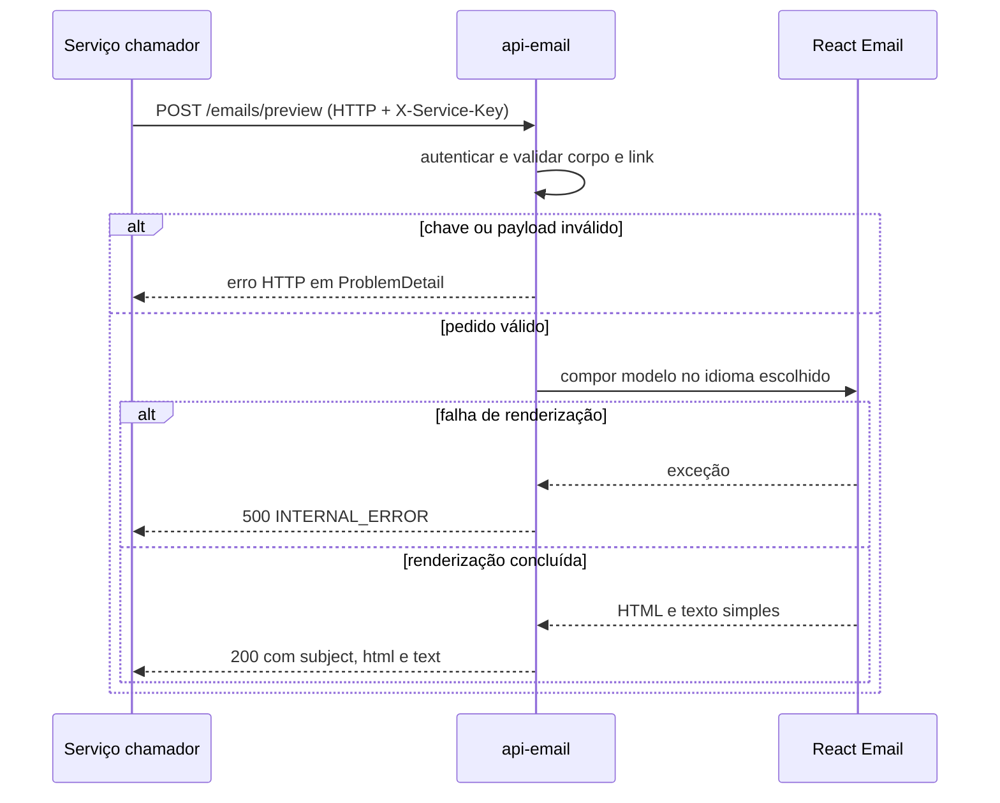

  

# Prévia de e-mail

O chamador pede uma prévia para conferir assunto e conteúdo do modelo antes do envio. A rota usa a mesma autenticação e validação do envio, mas devolve o resultado renderizado sem chamar o transporte.

As imagens incorporadas permanecem como data URI na prévia. Uma URL de imagem externa no modelo não é buscada pelo serviço. A configuração da aplicação continua sendo validada na partida, mesmo que a rota de prévia não use o transporte.

## Casos de erro

- Chave ausente ou inválida recebe 401.
- Campo desconhecido, modelo inválido ou dado obrigatório ausente recebe 422.
- Link fora das regras recebe 400 com `INVALID_ACTION_URL`.
- Corpo acima de 16 KiB recebe 413.
- Falha inesperada na renderização recebe 500.

O contrato está em [API.md](../docs/API.md). O passo seguinte é o [envio da mensagem](./SEND_EMAIL.md).
